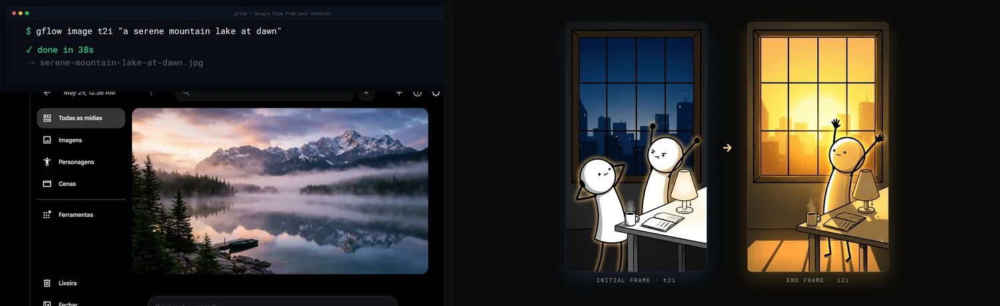
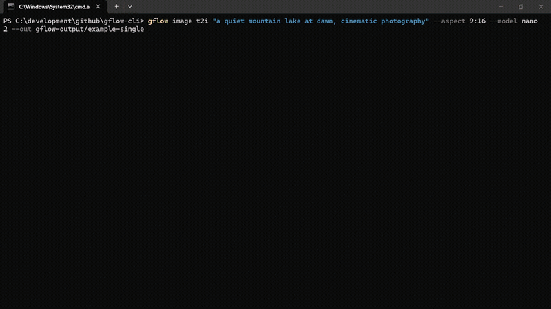

<!-- mcp-name: io.github.ffroliva/gflow-cli -->

# gflow-cli: MCP server and CLI for Google Flow (Veo 3.1, Omni, Nano Banana)

**English** | [简体中文](https://github.com/ffroliva/gflow-cli/blob/develop/README.zh-CN.md)

> **gflow-cli is an open-source MCP server and command-line tool that automates [Google Flow](https://labs.google/fx/tools/flow).** It generates Veo 3.1 and Omni video and Nano Banana and Imagen images from Claude Code, Claude Desktop, Cursor, Codex, VS Code or your terminal, billed to your own Google account's Flow credits. Use it as a Google Flow CLI or a Veo MCP server. Install it from PyPI with `uv tool install gflow-cli` (MIT, macOS, Windows and Linux).

[](https://pypi.org/project/gflow-cli/)
[](https://github.com/ffroliva/gflow-cli/actions/workflows/ci.yml)
[](https://pypi.org/project/gflow-cli/)
[](https://pepy.tech/project/gflow-cli)
[](LICENSE)
[](docs/PROJECT_STATUS.md)
[](https://sonarcloud.io/component_measures?id=ffroliva_gflow-cli&metric=coverage)
[](https://scorecard.dev/viewer/?uri=github.com/ffroliva/gflow-cli)
[](https://mcpservers.org/servers/ffroliva/gflow-cli)

<!-- Gold sponsors appear here: filled by scripts/ci/update_sponsors.py, empty until there is one. -->
<!-- sponsors-gold:start -->

<!-- sponsors-gold:end -->

**Why it exists: automation.** gflow-cli lets agents, harnesses and scripts generate images and videos on a user's own Google Flow account, predictably, and spend the credits the user pays for along a correct, accountable path. For these users Flow's web interface is noise. The browser is used only where it is strictly necessary, to mint the reCAPTCHA token each request carries, and it runs headless by default; the measured request shapes then go to Flow over direct HTTP. Which commands use a browser, and how, is listed per command in [BROWSER_MODES](docs/BROWSER_MODES.md). The remaining limits are stated under [Architecture & current limitations](#architecture--current-limitations).

<!-- browser-modes-table -->

An independent project, not affiliated with Google. It works on your own signed-in Flow session, so Google's terms apply to your account: read the [DISCLAIMER](DISCLAIMER.md) and [ACCOUNT_SAFETY](docs/ACCOUNT_SAFETY.md).

## gflow-cli at a glance

| | |
|---|---|
| **What it is** | One Python package that is both a CLI (`gflow`) and an MCP server (`gflow mcp run`, `gflow serve`) for Google Flow |
| **Agent surface** | **29 MCP tools** plus resources and prompts, over stdio and Streamable HTTP; listed in the [official MCP Registry](https://registry.modelcontextprotocol.io/) as `io.github.ffroliva/gflow-cli` |
| **Terminal surface** | 70+ commands with typed exit codes, most with `--json` output; `gflow --help --json` prints the whole tree for agents |
| **Video models** | Veo 3.1 Lite, Fast and Quality; Omni Flash and Omni 1.2 Flash (up to 15 s, up to 7 reference images) |
| **Image models** | Nano Banana 2.1, Nano Banana Pro, Nano Banana 2 Lite, Imagen 4 |
| **Works with** | Claude Code (plugin), Claude Desktop, Cursor, VS Code, Codex, any MCP client, shell scripts and CI |
| **Cost** | Free and MIT-licensed. Video bills your own Flow credits; images spend no credits (they count against a daily image quota) |
| **Maturity** | Releases are listed in the [changelog](https://github.com/ffroliva/gflow-cli/blob/main/CHANGELOG.md); every release since v0.54.0 is live-verified against real Google Flow before it ships |

## What can gflow-cli do?

- **Generate video**: text-to-video, image-to-video with a start and an end frame, and reference-to-video, on Veo 3.1 and Omni (`gflow video t2v | i2v | r2v`, or `gflow video generate` to pick the mode for you).
- **Make long videos**: `gflow video extend --segments N` continues a clip past Flow's 8 s limit with a continuous join, `gflow video chain` links shots frame to frame, and `gflow scene create` stitches clips server-side for free.
- **Generate images**: text-to-image and image-to-image, 1–4 per call, five aspect ratios (`gflow image t2i | i2i`).
- **Keep characters consistent**: `gflow character create` makes a reusable Flow Character (face, body, voice), and prompts can mention it as `@Name`.
- **Upscale**: video to 4K where Flow offers it for the item, 1080p or a GIF; images to 2K, or 4K on an Ultra plan.
- **Run batches and pipelines**: JSON batch runs where a row can build on an earlier row (`gflow run`), multi-scene films from a manifest (`gflow movie run`), and persistent Agent-Mode briefs (`gflow instructions`).
- **Rewrite prompts**: `--tool creative-director` and two other built-in prompt tools (`reverse-engineer`, `storyboard`), or your own ([TOOLS](docs/TOOLS.md)).
- **Track spend and media**: the Veo credit balance (`gflow credits`), a local media catalog (`gflow data`), a health check (`gflow doctor`), and output to S3, MinIO or Google Cloud Storage.

Features on the way are tracked in [#1367](https://github.com/ffroliva/gflow-cli/issues/1367).

## How do I connect Claude Code, Cursor or Codex to Google Flow?

Install gflow-cli and sign in once, then register the MCP server with your client.

```bash
uv tool install gflow-cli
gflow auth login --browser chrome
```

| Client | One step |
|---|---|
| **Claude Code** | `/plugin marketplace add ffroliva/gflow-cli` then `/plugin install gflow@gflow-cli` (adds the MCP server plus the `gflow-cli` and `video-production` skills) |
| **Claude Desktop** | `gflow mcp setup` |
| **Cursor** | `gflow mcp setup --target cursor` |
| **VS Code** | `gflow mcp setup --target vscode` |
| **Codex** | Skills: from a clone, `codex plugin marketplace add .` then `codex plugin add gflow@gflow-cli`; MCP: register `gflow mcp run` as a stdio server |
| **Any MCP client** | command `uvx`, arguments `gflow-cli mcp run`; or `gflow serve` for Streamable HTTP at `/mcp` |
| **OpenAI SDK code** | `gflow serve`, then `base_url="http://127.0.0.1:8000/v1"`: `POST /v1/images/generations` with Flow image models, `b64_json` responses ([docs/MCP.md](docs/MCP.md#openai-compatible-image-endpoint)) |

The Claude Code plugin ships disabled, because enabling it starts a server that can spend your Veo credits. For a hard guarantee, register `gflow mcp run --no-spend`, which never registers the credit-spending tools. Full setup: [docs/MCP.md](docs/MCP.md).

## 60-second quick start

**Before you install**, check that you have:

- Python 3.11 or newer (`uv tool install` fetches it) and [`uv`](https://docs.astral.sh/uv/getting-started/installation/);
- Google Chrome (it mints the reCAPTCHA token, headless by default, and hosts the sign-in);
- a display only for the one-time sign-in and for the commands that still drive Flow's interface ([BROWSER_MODES](docs/BROWSER_MODES.md));
- a Google account with Flow access, in a [region where Google offers Flow](https://support.google.com/flow/answer/16353544).

If PyPI, the Chromium download or Google is not reachable directly, read [Behind a proxy or a package mirror](https://github.com/ffroliva/gflow-cli/blob/develop/docs/USER_GUIDE.md#15-behind-a-proxy-or-a-package-mirror) first.

Compatible with **macOS** (Apple Silicon & Intel), **Windows**, and **Linux** (x86_64). The headless mint and direct HTTP transport were measured on Windows; macOS and Linux are unmeasured.

```bash
# 1 · Install (uv recommended; also: pip install gflow-cli)
uv tool install gflow-cli
uv tool run --from gflow-cli playwright install chromium     # one-time, ~150 MB
# optional extras: 'gflow-cli[tts]' for `audio narrate` (Edge), 'gflow-cli[chain]' for `video chain`/`assemble`/`captions`
# later: `gflow update` upgrades in place (other commands show a banner when a newer release is out)
# Windows pip install at 0.99.0 or older? Upgrade once by hand first (#1298):
#   close every gflow process, then <venv>\Scripts\python.exe -m pip install --upgrade gflow-cli
#   (keep your extras in the spec, e.g. "gflow-cli[patchright]", or their pins stay behind)
#   (a --user install: py -3.X -m pip install --user --upgrade gflow-cli; see https://github.com/ffroliva/gflow-cli/blob/main/docs/USAGE.md#gflow-update)

# 2 · Authenticate (one-time, opens a real Chrome window)
# Behind a proxy (e.g. Clash)? Set GFLOW_CLI_BROWSER_PROXY=http://127.0.0.1:7897 first; mirrors and details: docs/USER_GUIDE.md#15-behind-a-proxy-or-a-package-mirror
gflow auth login --browser chrome

# Check the session (spends nothing)
gflow auth status
gflow credits user          # Veo credit balance (no browser when the direct read is on and the saved session is accepted; spends nothing)
gflow capabilities          # what gflow can drive here: yes/no/partial per capability (no call to Flow)
gflow models list           # image and video models, aliases, durations (no call to Flow)
gflow doctor                # read-only pre-flight check; exit 33 means it found something to fix, not a crash
# Every error says whether Flow may have charged you and what to do next: docs/ERRORS.md

# 3 · Generate
gflow image t2i "a hot air balloon over Tokyo at sunrise"
# or:
gflow video t2v "Slow cinematic push-in on a sunlit forest clearing" --aspect 16:9
# or mint a reusable Character (face + body reference); it needs a project id:
# `gflow project create` makes a project; `gflow project list` shows the projects recorded in the local catalog
gflow character create --project <project-id> --name "Aria" --face-prompt "..." --body-prompt "..."
```

Outputs land under `$GFLOW_CLI_OUTPUT_DIR` (default: `gflow-cli` in your platform's Downloads folder, typically `~/Downloads/gflow-cli`), or you can route them to S3, MinIO, or Google Cloud Storage with [`GFLOW_CLI_STORAGE_URI`](docs/EXTERNAL_STORAGE.md). The first call takes 30 to 90 seconds while Chromium warms up; later calls reuse the warm session.

To save one result at an exact path, pass `--out-file PATH` (for example `gflow image t2i "..." --out-file hero.png`). Use `-o/--output` to select the output format (`json|table|id`). Non-format arguments to `-o` fail fast with exit 2 reminding you to use `--out-file`. See [USAGE](docs/USAGE.md#gflow-image-t2i).

Scripts that branch on exit codes can opt in to the stable core now (0 ok, 1 error, 2 usage, 3 auth, 130 interrupted) by setting `GFLOW_CLI_EXIT_CODES=2`. It becomes the default in a later release. See [ERRORS: the stable core](docs/ERRORS.md#exit-codes-the-stable-core-opt-in-in-this-release).

> **Why `--browser chrome`?** It is the only strategy that marks the profile as a real-Chrome profile, which is what later generation runs open it with. The default `auto` picks it whenever Chrome is installed — see [docs/AUTHENTICATION.md](docs/AUTHENTICATION.md).

> **Installing from a local checkout?** `uv tool install <path>` **ignores `uv.lock`** and resolves dependencies from the `pyproject.toml` ranges, so it can hand you a Playwright build this project has never tested. Playwright ships the browser driver, and an untested minor can wedge a generation silently. Carry the locked version explicitly:
>
> ```bash
> uv tool install --force --with playwright==1.61.0 .
> ```
>
> Installing from PyPI (`uv tool install gflow-cli`) is unaffected — the published range is upper-bounded. Check what you actually have with `uv tool run --from gflow-cli python -c "import importlib.metadata as m; print(m.version('playwright'))"`.

For the full 10-minute walkthrough with troubleshooting and multi-account setup, see **[USER_GUIDE: Journey 1](docs/USER_GUIDE.md#journey-1--first-time-setup-10-minutes)**.

## Which Google Flow models does gflow-cli support?

`gflow models list` prints the full list from the installed version (including `veo-lite-lp`, a lower-priority Veo 3.1 Lite), with no call to Flow. Its `retires on` column shows the models Flow has said it will retire.

| Kind | Model | Alias | Max length / refs |
|---|---|---|---|
| Video | Omni 1.2 Flash | `omni-1.2` | 15 s, 7 reference images |
| Video | Omni Flash (1.1) | `omni-flash` | 10 s, 7 reference images; Flow retires it on 2026-12-05 |
| Video | Veo 3.1 Quality | `veo-quality` | 8 s; Flow retires it on 2026-12-05 |
| Video | Veo 3.1 Fast | `veo-fast` | 8 s, 3 reference images; Flow retires it on 2026-12-05 |
| Video | Veo 3.1 Lite | `veo-lite` | 8 s, 3 reference images |
| Image | Nano Banana 2.1 | `nano2` | 10 reference images |
| Image | Nano Banana Pro | `nano-pro` | 10 reference images |
| Image | Nano Banana 2 Lite | `nano2-lite` | 3 reference images |
| Image | Imagen 4 (not in Flow's own menu) | `imagen4` | 3 reference images |

For the three models Flow retires on 2026-12-05, use `veo-lite` or `omni-1.2` instead ([known issue](KNOWN_ISSUES.md#flow-retires-omni-11-flash-veo-31-fast-and-veo-31-quality-on-2026-12-05)).

Video comes in 16:9 and 9:16; images in 16:9, 4:3, 1:1, 3:4 and 9:16. Which models and durations your account sees depends on your Flow plan; `gflow capabilities` reports what this install can drive.

## How does gflow-cli protect my Flow credits and my account?

- **Only video spends credits.** Image generation spends no credits (it counts against a daily image quota), and Scene stitching is free.
- **A server that cannot spend.** `gflow mcp run --no-spend` never registers the credit-spending tools, so an agent cannot call them at all.
- **Cost before commitment on multi-clip runs.** `video chain`, `video extend` and `movie run` take `--dry-run` to show the plan without submitting anything, and `chain` and `extend` ask before they spend.
- **Never billed twice.** A billed request is sent once and never retried automatically, and `gflow run --resume` regenerates only the rows the local catalog does not already hold.
- **Every error says whether you were charged.** Errors carry `charged: yes | no | maybe` and a `next_action` (`retry`, `reauth`, `reconcile`) in both the CLI's `--json` output and MCP replies ([ERRORS](docs/ERRORS.md)).
- **Paced, not disguised.** gflow paces its submissions, and the commands that still drive Flow's interface use randomised interaction timing. The headless browser reports itself as `HeadlessChrome`. It does no IP rotation, uses no proxy unless you set one, and does no fingerprint spoofing by default ([ACCOUNT_SAFETY](docs/ACCOUNT_SAFETY.md)).
- **Fails loudly.** When Flow's interface changes, the run stops with a distinct exit code (selector drift is exit 23) instead of guessing.

## How does gflow-cli compare with other Google Flow automation tools?

Compared from each project's own README on 2026-11-25. "—" means that README does not state it.

| | gflow-cli | [GTAI-1/flow-mcp](https://github.com/GTAI-1/flow-mcp) | [ByteLandTechnology/flow-mcp](https://github.com/ByteLandTechnology/flow-mcp) | [kodelyx/flow-agent](https://github.com/kodelyx/flow-agent) | [swissmarley/gflow-cli](https://github.com/swissmarley/gflow-cli) | [crisng95/flowkit](https://github.com/crisng95/flowkit) |
|---|---|---|---|---|---|---|
| Surfaces | CLI and MCP server (29 tools), parity enforced in CI | MCP server, local web panel | MCP server | CLI, MCP server (5 tools), OpenAI-compatible REST API | CLI | Chrome extension, local REST API, dashboards |
| Install | `uv tool install gflow-cli` (PyPI) | git clone, npm build | npm, binaries | clone, `pip install -e`, unpacked Chrome extension, bridge process | npm | git clone, load unpacked extension |
| Official MCP Registry | Yes | — | — | — | no MCP | no MCP |
| MCP over HTTP | Yes (`gflow serve`) | — | — | SSE (per its `docs/MCP_GUIDE.md`) | no MCP | no MCP |
| macOS / Windows / Linux | All three | macOS, Windows | All three | — | — | macOS, Linux; Windows through WSL or Git Bash |
| Licence | MIT | — | MIT | MIT (README; no licence file in the repository) | MIT | MIT |
| Video, image, start/end frames, references | Yes | Yes | Yes | Text- and image-to-video, text-to-image | Yes | Yes |
| Extend past 8 s | Yes | Yes | Yes | — | Yes (to 148 s) | — |
| Characters | Yes | Yes, with edit | Yes, with edit | — | Yes | Yes |
| Upscale | Video 4K/1080p, image 2K/4K | 1080p, 2K | — | — | 2K, 4K | Image 2K/4K export; video upscale not ported |
| OpenAI-compatible API | Images (`POST /v1/images/generations` on `gflow serve`); video planned ([#1365](https://github.com/ffroliva/gflow-cli/issues/1365)) | — | — | Yes | — | — |
| Pool credits across Google accounts | No (one profile per call; switch with `gflow auth use`) | — | — | Yes | — | — |
| Spend lockout for agents (`--no-spend`) | Yes | — | — | — | — | — |
| `charged` field on every error | Yes | — | — | — | — | — |
| Per-call credit cap | Yes (`--max-credits`, read from Flow's own quote) | Yes (`max_credits`) | — | — | — | — |
| Video-to-video edit | Yes (`video edit`, flow.google.com; local file with up to 5 references, or a clip) | Yes | Yes | — | — | — |
| Narration audio | Yes (audio narrate: edge-tts or Gemini voices) | Yes | — | — | — | Yes |
| Captions | Yes (`video captions`, `.srt` export) | Yes | — | — | — | — |
| Join clips | Yes, server-side (`scene create`) or local with music and voiceover (`video assemble`) | Yes, with music and voiceover | — | — | Yes (scene) | Yes, with music and narration |
| Bulk agent-mode image batch | Planned ([#1361](https://github.com/ffroliva/gflow-cli/issues/1361)) | Yes | — | — | — | — |
| Web control panel | Planned ([#1364](https://github.com/ffroliva/gflow-cli/issues/1364)) | Yes | — | — | — | Yes |
| Machine-readable self-description | `capabilities`, `--help --json`, `models`, `llms.txt`, agent skills | — | — | — | — | Agent skills |
| Live-verified against real Flow every release | Yes (since v0.54.0) | — | — | — | — | — |

**Which should I choose?**

- Choose gflow-cli for a CLI and an MCP server in one PyPI package, with a spend lockout (`--no-spend`) and a `charged` field on every error.
- Choose [GTAI-1/flow-mcp](https://github.com/GTAI-1/flow-mcp) for its local web panel.
- Choose [kodelyx/flow-agent](https://github.com/kodelyx/flow-agent) for credit pooling across Google accounts.
- Choose [crisng95/flowkit](https://github.com/crisng95/flowkit) for its Chrome extension and dashboards.

The full list of planned items is in [#1367](https://github.com/ffroliva/gflow-cli/issues/1367). A correction to a cell is welcome as an issue or a pull request.

## Frequently asked questions

### Is gflow-cli an official Google tool?

No. It is an independent, MIT-licensed project that drives your own signed-in Google Flow session.

### Is this the gflow-cli package on npm or JSR?

No. Other projects use the name, including Node.js packages on npm and JSR. This gflow-cli is the Python package on PyPI, maintained at [github.com/ffroliva/gflow-cli](https://github.com/ffroliva/gflow-cli) and listed in the MCP Registry as `io.github.ffroliva/gflow-cli`.

### Do I need a Gemini or Vertex AI API key?

No. gflow-cli uses your Google account's Flow access and Flow credits, not the pay-per-use API.

### Does it cost anything?

The tool is free. Video generation spends your Flow credits; image generation spends none but counts against a daily image quota.

### Can an AI agent spend my credits without asking?

Not when you register `gflow mcp run --no-spend`: the credit-spending tools are never registered. The Claude Code plugin also ships disabled.

### Does it run headless or on a server?

Mostly, yes. Sign-in needs a display once. After that, the measured image and video shapes mint their reCAPTCHA token in a headless Chrome and go to Flow over direct HTTP, with no visible window. Commands that still drive Flow's interface (for example `video r2v`, `video extend`, `video edit`, `character create`) open a headed window and need a display; on a Linux server that means Xvfb. The per-command list is in [BROWSER_MODES](docs/BROWSER_MODES.md); macOS, Linux and accounts Flow serves on labs.google are unmeasured (see [Architecture](#architecture--current-limitations)).

### Does it work with flow.google.com as well as labs.google?

Yes. It drives both Flow frontends and chooses the driver from the host that Flow serves for your account. On flow.google.com it supports text-to-video, image-to-video and reference-to-video from local files. It also supports Nano Banana image generation, a single-segment extend, image and video upscale, and characters by `@Name`. Features that are not ported yet still use the labs driver ([Architecture](#architecture--current-limitations)).

### Which Python version?

Python 3.11 or newer. `uv tool install gflow-cli` handles it for you.

### Is there a Google Flow API?

Google does not publish a public Flow API. gflow-cli drives your own signed-in Flow session and exposes it as a command-line tool, MCP tools and an OpenAI-compatible image endpoint (`gflow serve`, `POST /v1/images/generations`).

### Is there a Veo 3 CLI?

Yes. `gflow video t2v`, `i2v` and `r2v` generate Veo 3.1 video from the terminal, and the same operations are MCP tools. Omni models use the same commands.

### Where is Google Flow available?

Google lists the supported countries and territories in [Where you can use Google Flow](https://support.google.com/flow/answer/16353544). gflow-cli adds no regional access. If your network needs a proxy or a package mirror, see [Behind a proxy or a package mirror](https://github.com/ffroliva/gflow-cli/blob/develop/docs/USER_GUIDE.md#15-behind-a-proxy-or-a-package-mirror).


## Examples

One command in, real Flow output back. Left: `gflow image t2i` generating a photorealistic scene in your library. Right: a frame-to-frame transform.



## Demo



A single `gflow image t2i "..." --aspect 9:16 --model nano2` call against a logged-in Flow profile. The terminal streams the run's `structlog` JSON, then lists the written PNG. Chrome starts headless only to mint the reCAPTCHA token; the request itself goes to Flow over direct HTTP, so no browser window opens.

Reproduce the recording with [`scripts/record_demo.ps1`](scripts/record_demo.ps1) (Windows, OBS, ffmpeg, gifski). More formats, including the side-by-side split-screen: **[docs/DEMOS.md](docs/DEMOS.md)**.

## Documentation

[**docs/INDEX.md**](docs/INDEX.md) is the master routing layer. Quick links:

**Usage data:** gflow stores local usage counters and, after an interactive notice (and explicit consent in the EU/EEA), uploads weekly totals without an identifier. See [the privacy notice](docs/TELEMETRY.md) and [how to turn it off](docs/TELEMETRY.md#turn-usage-uploads-off-or-on).

| Topic | Read |
|---|---|
| 🎯 **Getting started** | [User Guide](docs/USER_GUIDE.md) · [Usage](docs/USAGE.md) · [Configuration](docs/CONFIGURATION.md) |
| **Storage & catalog** | [External Storage](docs/EXTERNAL_STORAGE.md) · [Data Layer](docs/DATA_LAYER.md) |
| 🎭 **Characters** | [Characters](docs/CHARACTER.md), reusable subjects (`gflow character`) |
| 🤖 **Agentic & automation** | [Instructions](docs/INSTRUCTIONS.md) (`gflow instructions`, persistent brief cards) · [Movie](docs/MOVIE.md) (`gflow movie`, multi-scene manifests) · [Tools](docs/TOOLS.md) (`--tool`, prompt rewriting) · [MCP server](docs/MCP.md) (`gflow mcp run` / `gflow serve`) |
| 🔐 **Auth & sessions** | [Authentication](docs/AUTHENTICATION.md) · [Known issues](KNOWN_ISSUES.md) |
| 📣 **Where to install from** | [Marketplaces](docs/MARKETPLACES.md) (every channel and what each actually delivers) · [Container](docs/CONTAINER.md) (why the image introspects but cannot generate) |
| 🏗️ **Internals** | [Architecture](docs/ARCHITECTURE.md) · [Security](docs/SECURITY.md) · [Usage data notice](docs/TELEMETRY.md) · [Debugging](docs/DEBUGGING.md) |
| 📦 **Releases** | [Changelog](CHANGELOG.md) · [Roadmap](ROADMAP.md) · [Release protocol](RELEASE.md) · [Project status](docs/PROJECT_STATUS.md) |
| 🤝 **Contributing** | [Contributing](CONTRIBUTING.md) · [Development](docs/DEVELOPMENT.md) · [GitHub workflow](docs/GITHUB.md) |

## For AI agents & LLMs

gflow-cli ships four agent entry points. Pick the one your tool reads first.

| File | Audience | Tools |
|---|---|---|
| [**AGENTS.md**](AGENTS.md) | Universal coding-agent spec | Cursor · Codex · Aider · Antigravity · Jules · Devin · Windsurf · Zed · Warp · opencode · Copilot |
| [**CLAUDE.md**](CLAUDE.md) | Claude Code's auto-loaded memory | Claude Code |
| [**llms.txt**](llms.txt) | LLM-readable summary (llmstxt.org format) | Paste into ChatGPT, Claude, or Gemini to onboard the model |
| [`skills/gflow-cli/SKILL.md`](skills/gflow-cli/SKILL.md) | Claude Code Skill | Symlink into `~/.claude/skills/` |

An agent can also read the whole command tree from the CLI itself: `gflow --help --json`.

To connect an MCP client, see [How do I connect Claude Code, Cursor or Codex to Google Flow?](#how-do-i-connect-claude-code-cursor-or-codex-to-google-flow)

Onboard any agent in one line. Paste this into your agent of choice:

> *"Read [AGENTS.md](https://github.com/ffroliva/gflow-cli/blob/main/AGENTS.md) and [docs/INDEX.md](https://github.com/ffroliva/gflow-cli/blob/main/docs/INDEX.md), then help me with my Flow batch."*

## Architecture & current limitations

```text
gflow CLI / MCP server
   ├─ measured shapes ─→ headless Chrome mints the reCAPTCHA token ─→ direct HTTP ─→ Flow
   └─ other surfaces  ─→ headed Chrome drives Flow's interface (ui_automation)    ─→ Flow
```

**Current transport.** For the request shapes that have been measured, gflow-cli starts Chrome headless only to mint the reCAPTCHA token and sends the request to Flow over direct HTTP: text-to-image, image-to-image with one in-project reference or one saved character, the image rows of `gflow run` that carry no reference, text-to-video at measured settings, image-to-video from a local start frame, and the 1080p video upscale. `gflow serve` and `gflow mcp run` follow the same rules. Flow refuses some submits as unusual activity without billing them; such a refusal is retried once, from a new headless browser process. `GFLOW_CLI_BROWSER_VISIBILITY` (`auto`, `headless`, `headed`; default `auto`) or `--browser-visibility headed` shows the window. The per-command list is in [BROWSER_MODES](docs/BROWSER_MODES.md); the evidence is the [direct video and headless mint spike](https://github.com/ffroliva/gflow-cli/blob/main/docs/superpowers/spikes/2026-11-27-direct-video-and-headless-mint.md) ([#1371](https://github.com/ffroliva/gflow-cli/issues/1371)). How the product worked before v0.108.0 is recorded once, in [ARCHITECTURE § Before v0.108.0](docs/ARCHITECTURE.md#before-v01080-a-headed-browser-for-generation).

**Two Flow frontends:** Google is moving accounts from `labs.google` to `flow.google.com` ([#639](https://github.com/ffroliva/gflow-cli/issues/639)). It is the same product with a different widget toolkit and wire protocol (`batchexecute` instead of `aisandbox-pa`). The migrated driver covers:

- text-to-video, image-to-video from a local start frame, and reference-to-video from local files;
- text-to-image and image-to-image from local files;
- a single-segment `video extend`.

Image generation supports Nano Banana 2.1 (`nano2`, [#958](https://github.com/ffroliva/gflow-cli/issues/958)), 2 Lite and Pro. It supports the five aspect ratios measured on that host (16:9, 4:3, 1:1, 3:4, 9:16) and counts 1–4. An existing project is required at the transport boundary. Images can tag a character by `@Name`. Reference-to-video takes a named character with `--reference-entity` and `--reference-entity-name` ([#723](https://github.com/ffroliva/gflow-cli/issues/723)). An account that is served the **agent-only** composer ([#799](https://github.com/ffroliva/gflow-cli/issues/799)) gets text-to-image and text-to-video only. An image `--ref <uuid>` is referenced in place when the catalog records it in the same `--project` ([#995](https://github.com/ffroliva/gflow-cli/issues/995)).

These keep the labs driver until they are ported: other UUID media references, an entity id without a name, instructions, Imagen 4, and the rest of the matrix (`GFLOW_CLI_FLOW_HOST`, see [CONFIGURATION](docs/CONFIGURATION.md#gflow_cli_flow_host)).

**Remaining limits.**

- The one-time `auth login` is interactive and needs a display.
- Reference-to-video, `video extend`, `video edit`, image-to-video with an end frame, the 4K, 720p and GIF upscales, `scene create`, `character create`, `instructions`, the agent-only composer, `media trash`/`restore`, image-to-image from local `--ref` files, and any video run with a credit cap (`--max-credits`, MCP `max_credits`) still drive Flow's interface in a headed browser. Headless operation of these surfaces is tracked in [#1554](https://github.com/ffroliva/gflow-cli/issues/1554).
- Request shapes that have not been measured fall back to the interface path.
- The headless mint was measured on Windows only, on accounts served flow.google.com. macOS, Linux and accounts Flow serves on labs.google are unmeasured.
- The headless browser reports itself as `HeadlessChrome`. It is not a stealth technique, and Google may treat it differently in future.

## Project status

**Beta.** These features run end-to-end on `ui_automation`:

- images: t2i, i2i, upload, upscale and batch;
- video: t2v, i2v, r2v, chain, extend and upscale;
- `image generate` and `video generate`, which pick the mode from the inputs;
- a six-model video picker (Veo 3.1 and Omni), plus `--duration` and `--count`.

Beyond single generations:

- `gflow movie` renders multi-scene manifests;
- `gflow instructions` manages persistent Agent-Mode brief cards (credits-free);
- `gflow character` handles reusable subjects;
- `gflow scene` does credit-free server-side stitching;
- `--tool` applies prompt-rewriting tools.

An MCP server (`gflow mcp run` for stdio, `gflow serve` for Streamable HTTP) exposes the core surface to AI agents. A CI-enforced CLI↔MCP parity contract keeps the two surfaces in step.

Full milestone history lives in [CHANGELOG.md](CHANGELOG.md). Where the project is heading: [ROADMAP.md](ROADMAP.md).

## Support gflow-cli

gflow-cli is maintained by one person. Every release is verified against real Google Flow, which spends real AI credits. Sponsorship pays for that verification.

[](https://github.com/sponsors/ffroliva/sponsorships?frequency=one-time&amount=5)
[](https://github.com/sponsors/ffroliva/sponsorships?frequency=monthly&amount=5)

Relying on gflow-cli at work? The monthly company tiers put your logo here, and Silver and above also get priority issues. All tiers and what each one gets: [docs/SPONSORS.md](docs/SPONSORS.md).

Patched gflow-cli in your fork? Please [open an issue](https://github.com/ffroliva/gflow-cli/issues) or a pull request — a fix that lands upstream helps everyone.

### Hall of fame

<!-- sponsors:start -->
No sponsors yet. <a href="https://github.com/sponsors/ffroliva/sponsorships?frequency=one-time&amp;amount=5">Be the first</a> — every public sponsor is listed here.
<!-- sponsors:end -->

## License & legal

[MIT License](LICENSE) © 2026 Flavio Oliva (`ffroliva`). The MIT license covers `gflow-cli`'s code only. It grants no rights to Flow, Veo model output, or any Google service. Google's own terms (Labs Additional Terms and any plan-specific subscription terms) govern your generations. See the [DISCLAIMER](DISCLAIMER.md).

## Acknowledgements

- [`edge-tts`](https://github.com/rany2/edge-tts), design inspiration for community SDKs over private cloud APIs.
- [`googleapis/python-genai`](https://github.com/googleapis/python-genai), the official Veo SDK that a future provider release may alias.
- [Keysight, *Google Labs – Flow AI with Veo3: A Network Traffic Analysis*](https://www.keysight.com/blogs/en/tech/nwvs/2025/08/04/google-flow-ai-har-analysis), an independent capture that helped validate the route patterns.

---

## Stats

[](https://github.com/ffroliva/gflow-cli/stargazers)
[](https://github.com/ffroliva/gflow-cli/network/members)
[](https://github.com/ffroliva/gflow-cli/watchers)
[](https://github.com/ffroliva/gflow-cli/issues)
[](https://github.com/ffroliva/gflow-cli/pulls)
[](https://github.com/ffroliva/gflow-cli/commits/main)
[](https://github.com/ffroliva/gflow-cli)
[](https://pepy.tech/project/gflow-cli)

### Project quality

[](https://sonarcloud.io/summary/new_code?id=ffroliva_gflow-cli)
[](https://github.com/ffroliva/gflow-cli/actions/workflows/release.yml)
[](https://github.com/microsoft/pyright)
[](https://github.com/astral-sh/ruff)
[](CONTRIBUTING.md)
[](docs/CONFIGURATION.md)
[](https://deepwiki.com/ffroliva/gflow-cli)

### Star history

<!-- DO NOT strip `sealed_token` from the URLs below. GitHub restricted the public
     /stargazers endpoint (2026-06-30), so star-history can only build this chart from a
     token-authenticated request. Its per-repo cache expires in <3 days, so a tokenless
     URL renders a "GitHub restricted access to star data" placard — served as HTTP 200,
     which is why nothing catches it. `.github/workflows/star-history-watch.yml` probes
     for exactly that. The token is sealed with star-history's key and grants metadata
     read on a public repo; it is safe in a public README, and they recommend it. -->
<picture>
  <source media="(prefers-color-scheme: dark)" srcset="https://api.star-history.com/chart?repos=ffroliva/gflow-cli&type=date&theme=dark&legend=top-left&sealed_token=7kTiE_HExjjY2aT7O-_hMxY_Mf6n-ET17mi_RXcRjCSS5rHSBDMd7xFYCzT_yaXhAXrgF8AGTQc6mny_qfuJc7473KGqb-5U41Dpu-tpZIS1IYl-xVQR9ziGJtL0KWQVyWZU1IoUmLWwo43PhgVTo4MJfmWOvluFJq2zlGxE_iLl9wMRgpwQaiC4ufOK" />
  
</picture>

If `gflow-cli` saves you time, please ⭐ the repo. It is the cheapest way to support the project.
