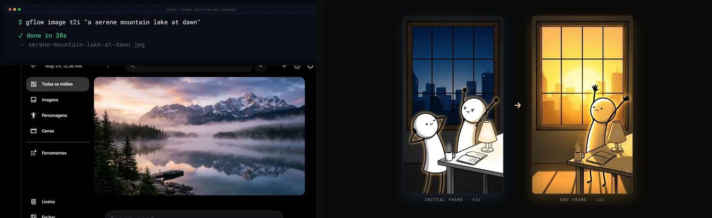
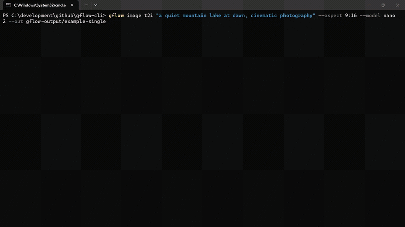

<!-- mcp-name: io.github.ffroliva/gflow-cli -->

# gflow-cli: Google Flow (Veo 3.1, Omni, Nano Banana) için MCP sunucusu ve CLI

[English](README.md) | [简体中文](README.zh-CN.md) | **Türkçe**

> **gflow-cli, [Google Flow](https://labs.google/fx/tools/flow) platformunu otomatikleştiren açık kaynaklı bir MCP sunucusu ve komut satırı aracıdır.** Claude Code, Claude Desktop, Cursor, Codex, VS Code veya terminalinizden kendi Google hesabınızın Flow kredilerini kullanarak Veo 3.1 ve Omni videoları ile Nano Banana ve Imagen görselleri üretir. Google Flow CLI veya Veo MCP sunucusu olarak kullanabilirsiniz. PyPI üzerinden `uv tool install gflow-cli` ile kurun (MIT, macOS, Windows ve Linux).

[](https://pypi.org/project/gflow-cli/)
[](https://github.com/ffroliva/gflow-cli/actions/workflows/ci.yml)
[](https://pypi.org/project/gflow-cli/)
[](https://pepy.tech/project/gflow-cli)
[](LICENSE)
[](docs/PROJECT_STATUS.md)
[](https://sonarcloud.io/component_measures?id=ffroliva_gflow-cli&metric=coverage)
[](https://scorecard.dev/viewer/?uri=github.com/ffroliva/gflow-cli)
[](https://mcpservers.org/servers/ffroliva/gflow-cli)

Bağımsız bir projedir, Google ile bağlantılı değildir. Gerçek bir Chrome penceresinde kendi oturum açmış Flow oturumunuzu kullanır; bu nedenle hesabınız için Google'ın koşulları geçerlidir: [DISCLAIMER](DISCLAIMER.md) ve [ACCOUNT_SAFETY](docs/ACCOUNT_SAFETY.md) belgelerini okuyun.

## Bir bakışta gflow-cli

| | |
|---|---|
| **Nedir?** | Google Flow için hem CLI (`gflow`) hem de MCP sunucusu (`gflow mcp run`, `gflow serve`) olan tek bir Python paketi |
| **Ajan yüzeyi** | stdio ve Streamable HTTP üzerinden **29 MCP aracı** artı kaynaklar ve istemler; [resmî MCP Kayıt Defterinde](https://registry.modelcontextprotocol.io/) `io.github.ffroliva/gflow-cli` olarak listelenmiştir |
| **Terminal yüzeyi** | Çoğu `--json` çıktılı, tipli çıkış kodlarına sahip 70+ komut; `gflow --help --json` ajanlar için tüm ağacı yazdırır |
| **Video modelleri** | Veo 3.1 Lite, Fast ve Quality; Omni Flash ve Omni 1.2 Flash (15 saniyeye kadar, 7 referans görsele kadar) |
| **Görsel modelleri** | Nano Banana 2.1, Nano Banana Pro, Nano Banana 2 Lite, Imagen 4 |
| **Uyumluluk** | Claude Code (eklenti), Claude Desktop, Cursor, VS Code, Codex, herhangi bir MCP istemcisi, kabuk betikleri ve CI |
| **Maliyet** | Ücretsiz ve MIT lisanslıdır. Video kendi Flow kredilerinizi harcar; görseller kredi harcamaz (günlük görsel kotasından düşer) |
| **Olgunluk** | Sürümler [değişiklik günlüğünde](https://github.com/ffroliva/gflow-cli/blob/main/CHANGELOG.md) listelenir; v0.54.0'dan beri her sürüm yayımlanmadan önce gerçek Google Flow üzerinde canlı doğrulanır |

## gflow-cli neler yapabilir?

- **Video üretme**: Veo 3.1 ve Omni üzerinde metinden videoya, başlangıç ve bitiş kareli görselden videoya ve referanstan videoya (`gflow video t2v | i2v | r2v`, veya kipi sizin yerinize seçmesi için `gflow video generate`).
- **Uzun videolar yapma**: `gflow video extend --segments N` bir klibi kesintisiz birleştirmeyle Flow'un 8 saniye sınırının ötesine uzatır, `gflow video chain` çekimleri kareden kareye bağlar ve `gflow scene create` klipleri sunucu tarafında ücretsiz birleştirir.
- **Görsel üretme**: metinden görsele ve görselden görsele, çağrı başına 1–4 adet, beş en-boy oranı (`gflow image t2i | i2i`).
- **Karakter tutarlılığını koruma**: `gflow character create` yeniden kullanılabilir bir Flow Karakteri (yüz, vücut, ses) oluşturur ve istemlerde `@Name` olarak anılabilir.
- **Ölçek yükseltme (Upscale)**: Flow'un sunduğu öğelerde videoyu 4K, 1080p veya GIF'e; görselleri 2K'ya (Ultra planda 4K'ya) yükseltir.
- **Toplu işler ve işlem hatları çalıştırma**: bir satırın önceki satır üzerine inşa edilebildiği JSON toplu çalıştırmaları (`gflow run`), bir bildirimden çok sahneli filmler (`gflow movie run`) ve kalıcı Ajan Kipi brifingleri (`gflow instructions`).
- **İstemleri yeniden yazma**: `--tool creative-director` ve diğer iki yerleşik istem aracı (`reverse-engineer`, `storyboard`) veya kendi araçlarınız ([TOOLS](docs/TOOLS.md)).
- **Harcama ve medyayı takip etme**: Veo kredi bakiyesi (`gflow credits`), yerel medya kataloğu (`gflow data`), sağlık kontrolü (`gflow doctor`) ve S3, MinIO veya Google Cloud Storage'a çıktı.

Yoldaki özellikler [#1367](https://github.com/ffroliva/gflow-cli/issues/1367) altında izlenir.

## Claude Code, Cursor veya Codex'i Google Flow'a nasıl bağlarım?

`gflow-cli` kurun, bir kez oturum açın, ardından MCP sunucusunu istemcinize kaydedin.

```bash
uv tool install gflow-cli
gflow auth login --browser chrome
```

| İstemci | Tek adım |
|---|---|
| **Claude Code** | `/plugin marketplace add ffroliva/gflow-cli` ardından `/plugin install gflow@gflow-cli` (MCP sunucusu ile `gflow-cli` ve `video-production` becerilerini ekler) |
| **Claude Desktop** | `gflow mcp setup` |
| **Cursor** | `gflow mcp setup --target cursor` |
| **VS Code** | `gflow mcp setup --target vscode` |
| **Codex** | Beceriler: klondan `codex plugin marketplace add .` ardından `codex plugin add gflow@gflow-cli`; MCP: `gflow mcp run` komutunu stdio sunucusu olarak kaydedin |
| **Herhangi bir MCP istemcisi** | komut `uvx`, argümanlar `gflow-cli mcp run`; veya `/mcp` üzerinde Streamable HTTP için `gflow serve` |
| **OpenAI SDK kodu** | `gflow serve`, ardından `base_url="http://127.0.0.1:8000/v1"`: Flow görsel modelleriyle `POST /v1/images/generations`, `b64_json` yanıtları ([docs/MCP.md](docs/MCP.md#openai-compatible-image-endpoint)) |

Claude Code eklentisi, etkinleştirilmesi Veo kredilerinizi harcayabilecek bir sunucu başlattığı için varsayılan olarak kapalı gelir. Kesin bir güvence için kredi harcayan araçları hiç kaydetmeyen `gflow mcp run --no-spend` komutunu kaydedin. Tam kurulum: [docs/MCP.md](docs/MCP.md).

## 60 saniyelik hızlı başlangıç

**Kurmadan önce** şunlara sahip olduğunuzu kontrol edin:

- Python 3.11 veya üzeri (`uv tool install` bunu indirir) ve [`uv`](https://docs.astral.sh/uv/getting-started/installation/);
- Google Chrome (oturum açma ve üretim gerçek bir Chrome penceresini sürer);
- tek seferlik oturum açma için bir ekran (Linux sunucularında Xvfb);
- [Google'ın Flow sunduğu bir bölgede](https://support.google.com/flow/answer/16353544) Flow erişimine sahip bir Google hesabı.

PyPI, Chromium indirmesi veya Google'a doğrudan erişilemiyorsa önce [Vekil sunucu veya paket yansısı arkasında](https://github.com/ffroliva/gflow-cli/blob/develop/docs/USER_GUIDE.md#15-behind-a-proxy-or-a-package-mirror) bölümünü okuyun.

**macOS** (Apple Silicon ve Intel), **Windows** ve **Linux** (x86_64 / Xvfb) ile uyumludur.

```bash
# 1 · Kurulum (uv önerilir; alternatif: pip install gflow-cli)
uv tool install gflow-cli
uv tool run --from gflow-cli playwright install chromium     # tek seferlik, ~150 MB
# isteğe bağlı ekler: `audio narrate` (Edge) için 'gflow-cli[tts]', `video chain`/`assemble`/`captions` için 'gflow-cli[chain]'
# daha sonra: `gflow update` yerinde yükseltir

# 2 · Kimlik doğrulama (tek seferlik, gerçek bir Chrome penceresi açar)
gflow auth login --browser chrome

# Oturumu kontrol et (kredi harcamaz)
gflow auth status
gflow credits user          # Veo kredi bakiyesi
gflow capabilities          # bu kurulumun neleri çalıştırabileceği (Flow'a çağrı yapmaz)
gflow models list           # görsel ve video modelleri, takma adlar, süreler (Flow'a çağrı yapmaz)
gflow doctor                # salt-okunur ön kontrol; çıkış kodu 33 çökme değil düzeltilecek bir şey bulduğu anlamına gelir

# 3 · Üret
gflow image t2i "a hot air balloon over Tokyo at sunrise"
# veya:
gflow video t2v "Slow cinematic push-in on a sunlit forest clearing" --aspect 16:9
# veya yeniden kullanılabilir bir Karakter oluştur:
gflow character create --project <project-id> --name "Aria" --face-prompt "..." --body-prompt "..."
```

Çıktılar `$GFLOW_CLI_OUTPUT_DIR` altına (varsayılan: İndirilenler klasörünüzde `gflow-cli`, genellikle `~/Downloads/gflow-cli`) kaydedilir veya [`GFLOW_CLI_STORAGE_URI`](docs/EXTERNAL_STORAGE.md) ile S3, MinIO ya da Google Cloud Storage'a yönlendirilebilir. İlk çağrı Chromium ısınırken 30–90 saniye sürer; sonraki çağrılar sıcak oturumu yeniden kullanır.

Tek bir sonucu belirli bir yola kaydetmek için `--out-file PATH` geçin (örneğin `gflow image t2i "..." --out-file hero.png`). Çıktı biçimini (`json|table|id`) seçmek için `-o/--output` kullanın. Bkz. [USAGE](docs/USAGE.md#gflow-image-t2i).

> **Neden `--browser chrome`?** Profili gerçek bir Chrome profili olarak işaretleyen tek stratejidir ve sonraki üretim çalıştırmaları profili bu şekilde açar. Varsayılan `auto`, Chrome kurulu olduğunda bunu otomatik seçer — bkz. [docs/AUTHENTICATION.md](docs/AUTHENTICATION.md).

> **Yerel bir klondan mı kuruyorsunuz?** `uv tool install <path>` komutu **`uv.lock` dosyasını yok sayar**. Kilitli sürümü açıkça belirtin:
>
> ```bash
> uv tool install --force --with playwright==1.61.0 .
> ```

Sorun giderme ve çoklu hesap kurulumuyla tam 10 dakikalık rehber için **[USER_GUIDE: Journey 1](docs/USER_GUIDE.md#journey-1--first-time-setup-10-minutes)** belgesine bakın.

## gflow-cli hangi Google Flow modellerini destekler?

`gflow models list` Flow'a çağrı yapmadan kurulu sürümdeki tam listeyi yazdırır. `retires on` sütunu Flow'un kullanımdan kaldıracağını duyurduğu modelleri gösterir.

| Tür | Model | Takma Ad | Maks. süre / referans |
|---|---|---|---|
| Video | Omni 1.2 Flash | `omni-1.2` | 15 sn, 7 referans görsel |
| Video | Omni Flash (1.1) | `omni-flash` | 10 sn, 7 referans görsel; Flow 2026-12-05'te kaldırıyor |
| Video | Veo 3.1 Quality | `veo-quality` | 8 sn; Flow 2026-12-05'te kaldırıyor |
| Video | Veo 3.1 Fast | `veo-fast` | 8 sn, 3 referans görsel; Flow 2026-12-05'te kaldırıyor |
| Video | Veo 3.1 Lite | `veo-lite` | 8 sn, 3 referans görsel |
| Görsel | Nano Banana 2.1 | `nano2` | 10 referans görsel |
| Görsel | Nano Banana Pro | `nano-pro` | 10 referans görsel |
| Görsel | Nano Banana 2 Lite | `nano2-lite` | 3 referans görsel |
| Görsel | Imagen 4 (Flow'un kendi menüsünde yok) | `imagen4` | 3 referans görsel |

Flow'un 2026-12-05 tarihinde kullanımdan kaldıracağı üç model yerine `veo-lite` veya `omni-1.2` kullanın ([bilinen sorun](KNOWN_ISSUES.md#flow-retires-omni-11-flash-veo-31-fast-and-veo-31-quality-on-2026-12-05)).

Videolar 16:9 ve 9:16; görseller 16:9, 4:3, 1:1, 3:4 ve 9:16 oranlarında üretilir. Hesabınızın hangi modelleri ve süreleri gördüğü Flow planınıza bağlıdır; `gflow capabilities` bu kurulumun neleri sürebileceğini raporlar.

## gflow-cli Flow kredilerimi ve hesabımı nasıl korur?

- **Yalnızca video kredi harcar.** Görsel üretimi kredi harcamaz (günlük görsel kotasından düşer) ve Sahne birleştirme ücretsizdir.
- **Harcama yapamayan sunucu.** `gflow mcp run --no-spend` kredi harcayan araçları asla kaydetmez; böylece bir ajan bunları hiç çağıramaz.
- **Çok klipli çalıştırmalarda onay öncesi maliyet.** `video chain`, `video extend` ve `movie run` hiçbir şey göndermeden planı göstermek için `--dry-run` alır; `chain` ve `extend` harcama öncesi sorar.
- **Asla iki kez faturalandırılmaz.** Ücretli bir istek bir kez gönderilir ve otomatik olarak yeniden denenmez; `gflow run --resume` yalnızca yerel katalogda henüz bulunmayan satırları yeniden üretir.
- **Her hata ücret kesilip kesilmediğini söyler.** Hatalar hem CLI'ın `--json` çıktısında hem de MCP yanıtlarında `charged: yes | no | maybe` ve `next_action` (`retry`, `reauth`, `reconcile`) taşır ([ERRORS](docs/ERRORS.md)).
- **İnsan temposunda çalışır.** `gflow` rastgeleleştirilmiş etkileşim zamanlaması ve dengeli gönderimlerle gerçek bir Chrome penceresi kullanır. IP rotasyonu yapmaz, siz ayarlamadıkça vekil sunucu kullanmaz ve varsayılan olarak parmak izi taklidi yapmaz ([ACCOUNT_SAFETY](docs/ACCOUNT_SAFETY.md)).
- **Açıkça hata verir.** Flow arayüzü değiştiğinde tahmin yürütmek yerine belirgin bir çıkış koduyla durur (seçici kayması çıkış kodu 23'tür).

## Sıkça Sorulan Sorular

### gflow-cli resmî bir Google aracı mı?
Hayır. Kendi oturum açmış Google Flow oturumunuzu yöneten bağımsız, MIT lisanslı bir projedir.

### Bu, npm veya JSR'deki gflow-cli paketi mi?
Hayır. Başka projeler de bu adı kullanır. Bu `gflow-cli`, PyPI'daki Python paketidir; [github.com/ffroliva/gflow-cli](https://github.com/ffroliva/gflow-cli) adresinde sürdürülür ve MCP Kayıt Defterinde `io.github.ffroliva/gflow-cli` olarak listelenir.

### Gemini veya Vertex AI API anahtarına ihtiyacım var mı?
Hayır. `gflow-cli` kullandıkça öde API'sini değil, Google hesabınızın Flow erişimini ve Flow kredilerini kullanır.

### Ücretli mi?
Araç ücretsizdir. Video üretimi Flow kredilerinizi harcar; görsel üretimi kredi harcamaz ancak günlük görsel kotasından düşer.

### Bir yapay zekâ ajanı bana sormadan kredilerimi harcayabilir mi?
`gflow mcp run --no-spend` ile kaydettiğinizde hayır: kredi harcayan araçlar hiç kaydedilmez. Claude Code eklentisi de varsayılan olarak kapalı gelir.

### Başsız (headless) veya bir sunucuda çalışır mı?
Oturum açma bir kez ekran gerektirir. Üretim gerçek bir Chrome penceresini sürdüğünden Linux sunucularında Xvfb altında çalışır. Video için saf HTTP aktarımı Google'ın reCAPTCHA korumasıyla engellenir (bkz. [Mimari](#mimari-ve-mevcut-sınırlamalar)).

### `labs.google` yanında `flow.google.com` ile de çalışır mı?
Evet. Her iki Flow ön yüzünü de destekler ve hesabınıza sunulan sunucuya göre sürücüyü seçer.

### Hangi Python sürümü gerekir?
Python 3.11 veya üzeri. `uv tool install gflow-cli` bunu sizin yerinize yönetir.

## Örnekler ve Demo





## Belgeler

[**docs/INDEX.md**](docs/INDEX.md) ana yönlendirme katmanıdır:

| Konu | Bağlantılar |
|---|---|
| 🎯 **Başlarken** | [Kullanıcı Kılavuzu](docs/USER_GUIDE.md) · [Kullanım](docs/USAGE.md) · [Yapılandırma](docs/CONFIGURATION.md) |
| **Depolama ve katalog** | [Harici Depolama](docs/EXTERNAL_STORAGE.md) · [Veri Katmanı](docs/DATA_LAYER.md) |
| 🎭 **Karakterler** | [Karakterler](docs/CHARACTER.md), yeniden kullanılabilir özneler (`gflow character`) |
| 🤖 **Ajan ve otomasyon** | [Talimatlar](docs/INSTRUCTIONS.md) · [Film](docs/MOVIE.md) · [Araçlar](docs/TOOLS.md) · [MCP sunucusu](docs/MCP.md) |
| 🔐 **Kimlik doğrulama ve oturumlar** | [Kimlik Doğrulama](docs/AUTHENTICATION.md) · [Bilinen sorunlar](KNOWN_ISSUES.md) |
| 📣 **Nereden kurulur?** | [Pazar Yerleri](docs/MARKETPLACES.md) · [Kapsayıcı](docs/CONTAINER.md) |
| 🏗️ **İç yapı** | [Mimari](docs/ARCHITECTURE.md) · [Güvenlik](docs/SECURITY.md) · [Kullanım verisi bildirimi](docs/TELEMETRY.md) · [Hata Ayıklama](docs/DEBUGGING.md) |
| 📦 **Sürümler** | [Değişiklik Günlüğü](CHANGELOG.md) · [Yol Haritası](ROADMAP.md) · [Sürüm protokolü](RELEASE.md) · [Proje durumu](docs/PROJECT_STATUS.md) |
| 🤝 **Katkıda bulunma** | [Katkıda Bulunma](CONTRIBUTING.md) · [Geliştirme](docs/DEVELOPMENT.md) · [GitHub iş akışı](docs/GITHUB.md) |

## Yapay zekâ ajanları ve LLM'ler için

| Dosya | Hedef Kitle | Araçlar |
|---|---|---|
| [**AGENTS.md**](AGENTS.md) | Evrensel kodlama ajanı spesifikasyonu | Cursor · Codex · Aider · Antigravity · Jules · Devin · Windsurf · Zed · Warp · opencode · Copilot |
| [**CLAUDE.md**](CLAUDE.md) | Claude Code otomatik yüklenen bellek | Claude Code |
| [**llms.txt**](llms.txt) | LLM tarafından okunabilir özet (`llmstxt.org` biçimi) | Modeli hazırlamak için ChatGPT, Claude veya Gemini'ye yapıştırın |
| [`skills/gflow-cli/SKILL.md`](skills/gflow-cli/SKILL.md) | Claude Code Becerisi | `~/.claude/skills/` içine sembolik bağlantı oluşturun |

## Mimari ve mevcut sınırlamalar

```text
gflow CLI  →  Provider (değiştirilebilir)  →  Flow (ui_automation) / Mock (testler)
                                              ↓
                                      Playwright Chromium (varsayılan olarak pencereli)
                                              ↓
                              aisandbox-pa.googleapis.com  (Google'ın özel Flow API'si)
```

- **Mevcut aktarım:** `ui_automation` kalıcı bir Playwright Chromium profili üzerinden Flow'u yönetir ve her sürümde uçtan uca doğrulanır.
- **İki Flow ön yüzü:** Google hesapları `labs.google` adresinden `flow.google.com` adresine taşıyor ([#639](https://github.com/ffroliva/gflow-cli/issues/639)); `gflow-cli` her ikisini de destekler.
- **Engellenen nokta:** Video üretimi için saf HTTP aktarımı (Chrome dışı tarayıcılarda HTTP 401 ve reCAPTCHA gereksinimi). Ayrıntılar: [docs/ARCHITECTURE.md](docs/ARCHITECTURE.md#headed-browser-dependency--current-limitation).

## gflow-cli'ı destekleyin

`gflow-cli` tek kişi tarafından sürdürülmektedir. Her sürüm gerçek yapay zekâ kredileri harcanarak gerçek Google Flow üzerinde doğrulanır. Sponsorluklar bu doğrulama maliyetini karşılar.

[](https://github.com/sponsors/ffroliva/sponsorships?frequency=one-time&amount=5)
[](https://github.com/sponsors/ffroliva/sponsorships?frequency=monthly&amount=5)

## Lisans ve yasal bilgilendirme

[MIT Lisansı](LICENSE) © 2026 Flavio Oliva (`ffroliva`). MIT lisansı yalnızca `gflow-cli` kodunu kapsar; Flow, Veo model çıktıları veya herhangi bir Google servisi üzerinde hak vermez. Üretimleriniz Google'ın kendi koşullarına tabidir. Bkz. [DISCLAIMER](DISCLAIMER.md).

`gflow-cli` size zaman kazandırıyorsa lütfen depoya ⭐ yıldız verin. Projeyi desteklemenin en kolay yoludur.
