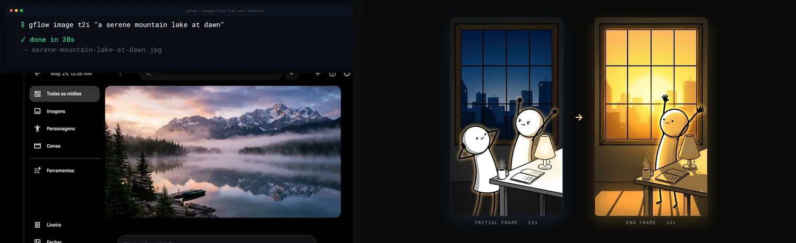
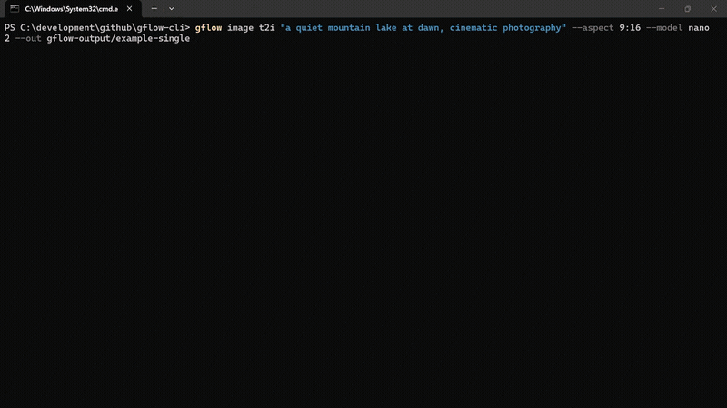

<!-- mcp-name: io.github.ffroliva/gflow-cli -->

# gflow-cli：Google Flow 的 MCP 服务器和命令行工具（Veo 3.1、Omni、Nano Banana）

[English](README.md) | **简体中文**

> **gflow-cli 是一个开源的 MCP 服务器和命令行工具，用于自动化 [Google Flow](https://labs.google/fx/tools/flow)。** 它可以在 Claude Code、Claude Desktop、Cursor、Codex、VS Code 或终端中生成 Veo 3.1 和 Omni 视频，以及 Nano Banana 和 Imagen 图片，费用计入你自己 Google 账号的 Flow 积分。可作为 Google Flow 命令行工具或 Veo MCP 服务器使用。通过 PyPI 安装：`uv tool install gflow-cli`（MIT 许可，支持 macOS、Windows 和 Linux）。

> 本文是 [README.md](README.md) 的中文翻译，内容以英文版为准；省略了徽章、统计数据、赞助者名单和 Star 历史，完整内容见英文版。命令、参数和程序输出保持英文。如发现翻译不准确，欢迎提交 [issue](https://github.com/ffroliva/gflow-cli/issues) 或 pull request。

[](https://pypi.org/project/gflow-cli/)
[](https://github.com/ffroliva/gflow-cli/actions/workflows/ci.yml)
[](https://pypi.org/project/gflow-cli/)
[](https://pepy.tech/project/gflow-cli)
[](LICENSE)
[](docs/PROJECT_STATUS.md)

本项目是独立项目，与 Google 无关联。它在真实的 Chrome 窗口中驱动你自己已登录的 Flow 会话，因此 Google 的条款适用于你的账号：请阅读 [DISCLAIMER](DISCLAIMER.md) 和 [ACCOUNT_SAFETY](docs/ACCOUNT_SAFETY.md)。

## gflow-cli 概览

| | |
|---|---|
| **它是什么** | 一个 Python 包，同时是 Google Flow 的命令行工具（`gflow`）和 MCP 服务器（`gflow mcp run`、`gflow serve`） |
| **面向智能体** | **29 个 MCP 工具**，外加资源和提示词，支持 stdio 和 Streamable HTTP；已在[官方 MCP Registry](https://registry.modelcontextprotocol.io/) 中登记为 `io.github.ffroliva/gflow-cli` |
| **面向终端** | 70 多个命令，退出码有明确类型，大多数支持 `--json` 输出；`gflow --help --json` 可为智能体输出完整命令树 |
| **视频模型** | Veo 3.1 Lite、Fast 和 Quality；Omni Flash 和 Omni 1.2 Flash（最长 15 秒，最多 7 张参考图） |
| **图片模型** | Nano Banana 2.1、Nano Banana Pro、Nano Banana 2 Lite、Imagen 4 |
| **适用于** | Claude Code（插件）、Claude Desktop、Cursor、VS Code、Codex、任意 MCP 客户端、Shell 脚本和 CI |
| **费用** | 免费，MIT 许可。视频消耗你自己的 Flow 积分；图片不消耗积分（计入每日图片配额） |
| **成熟度** | 各版本记录在[更新日志](https://github.com/ffroliva/gflow-cli/blob/main/CHANGELOG.md)中；自 v0.54.0 起，每个版本发布前都会在真实的 Google Flow 上实测验证 |

## gflow-cli 能做什么？

- **生成视频**：文生视频、带首帧和尾帧的图生视频，以及参考图生视频，支持 Veo 3.1 和 Omni（`gflow video t2v | i2v | r2v`，或用 `gflow video generate` 自动选择模式）。
- **制作长视频**：`gflow video extend --segments N` 可将片段延长到超过 Flow 的 8 秒上限，衔接连贯；`gflow video chain` 将镜头逐帧串联；`gflow scene create` 在服务器端免费拼接片段。
- **生成图片**：文生图和图生图，每次 1 到 4 张，五种画面比例（`gflow image t2i | i2i`）。
- **保持角色一致**：`gflow character create` 创建可复用的 Flow 角色（面部、身体、声音），提示词中可用 `@Name` 引用。
- **放大**：Flow 为该项目提供 4K 时，视频可放大到 4K，也可放大到 1080p 或导出 GIF；图片放大到 2K，Ultra 套餐可放大到 4K。
- **批处理和流水线**：JSON 批量运行，后面的行可以基于前面的行生成（`gflow run`）；根据清单文件生成多场景影片（`gflow movie run`）；持久化的智能体模式（Agent Mode）指令卡（`gflow instructions`）。
- **改写提示词**：`--tool creative-director` 以及另外两个内置提示词工具（`reverse-engineer`、`storyboard`），也可以使用你自己的工具（[TOOLS](docs/TOOLS.md)）。
- **跟踪花费和媒体**：Veo 积分余额（`gflow credits`）、本地媒体库（catalog，`gflow data`）、健康检查（`gflow doctor`），并可将输出保存到 S3、MinIO 或 Google Cloud Storage。

即将推出的功能记录在 [#1367](https://github.com/ffroliva/gflow-cli/issues/1367)。

## 连接 AI 客户端

安装 gflow-cli 并登录一次，然后在你的客户端中注册 MCP 服务器。

```bash
uv tool install gflow-cli
gflow auth login --browser chrome
```

| 客户端 | 一步完成 |
|---|---|
| **Claude Code** | `/plugin marketplace add ffroliva/gflow-cli`，然后 `/plugin install gflow@gflow-cli`（添加 MCP 服务器以及 `gflow-cli` 和 `video-production` 两个技能） |
| **Claude Desktop** | `gflow mcp setup` |
| **Cursor** | `gflow mcp setup --target cursor` |
| **VS Code** | `gflow mcp setup --target vscode` |
| **Codex** | 技能：在克隆的仓库中运行 `codex plugin marketplace add .`，然后 `codex plugin add gflow@gflow-cli`；MCP：将 `gflow mcp run` 注册为 stdio 服务器 |
| **任意 MCP 客户端** | 命令 `uvx`，参数 `gflow-cli mcp run`；或用 `gflow serve` 在 `/mcp` 提供 Streamable HTTP |
| **OpenAI SDK 代码** | 运行 `gflow serve`，然后设置 `base_url="http://127.0.0.1:8000/v1"`：`POST /v1/images/generations`，使用 Flow 图片模型，返回 `b64_json`（[docs/MCP.md](docs/MCP.md#openai-compatible-image-endpoint)） |

Claude Code 插件默认处于禁用状态，因为启用后会启动一个可能消耗你 Veo 积分的服务器。如需硬性保证，请注册 `gflow mcp run --no-spend`，它不会注册任何消耗积分的工具。完整配置：[docs/MCP.md](docs/MCP.md)。

## 快速上手

**安装之前**，请确认你具备：

- Python 3.11 或更高版本（`uv tool install` 会自动获取）和 [`uv`](https://docs.astral.sh/uv/getting-started/installation/)；
- Google Chrome（登录和生成都会驱动真实的 Chrome 窗口）；
- 一个图形界面，用于一次性登录（Linux 服务器上使用 Xvfb）；
- 一个有 Flow 使用权限的 Google 账号，且所在地区在 [Google 提供 Flow 服务的地区](https://support.google.com/flow/answer/16353544)之内。

如果 PyPI、Chromium 下载或 Google 无法直接访问，请先阅读下文的[网络与地区](#网络与地区)。

支持 **macOS**（Apple Silicon 和 Intel）、**Windows** 和 **Linux**（x86_64 / Xvfb）。

```bash
# 1 · 安装（推荐 uv；也可以用 pip install gflow-cli）
uv tool install gflow-cli
uv tool run --from gflow-cli playwright install chromium     # 只需一次，约 150 MB
# 可选扩展：'gflow-cli[tts]' 用于 `audio narrate`（Edge），'gflow-cli[chain]' 用于 `video chain`/`assemble`/`captions`
# 以后：`gflow update` 原地升级（有新版本时，其他命令会显示提示）
# Windows 上用 pip 安装的 0.99.0 或更早版本？请先手动升级一次（#1298）：
#   关闭所有 gflow 进程，然后运行 <venv>\Scripts\python.exe -m pip install --upgrade gflow-cli
#   （升级时保留你的扩展，例如 "gflow-cli[patchright]"，否则它们的固定版本不会更新）
#   （--user 安装：py -3.X -m pip install --user --upgrade gflow-cli；见 https://github.com/ffroliva/gflow-cli/blob/main/docs/USAGE.md#gflow-update）

# 2 · 登录（只需一次，会打开真实的 Chrome 窗口）
# 使用代理（例如 Clash）？请先设置 GFLOW_CLI_BROWSER_PROXY=http://127.0.0.1:7897；详见下文“网络与地区”
gflow auth login --browser chrome

# 检查会话（不消耗任何积分）
gflow auth status
gflow credits user          # Veo 积分余额（开启直接读取且已保存的会话被接受时不启动浏览器；不消耗积分）
gflow capabilities          # gflow 在这里能驱动什么：每项能力为 yes/no/partial（不访问 Flow）
gflow models list           # 图片和视频模型、别名、时长（不访问 Flow）
gflow doctor                # 只读的预检：退出码 33 表示发现了需要处理的问题，不是程序崩溃
# 每个错误都会说明 Flow 是否可能已扣费，以及下一步该怎么做：docs/ERRORS.md

# 3 · 生成
gflow image t2i "a hot air balloon over Tokyo at sunrise"
# 或者：
gflow video t2v "Slow cinematic push-in on a sunlit forest clearing" --aspect 16:9
# 或者创建一个可复用的角色（面部 + 身体参考），它需要一个项目 ID：
# `gflow project create` 创建项目；`gflow project list` 列出本地媒体库中记录的项目
gflow character create --project <project-id> --name "Aria" --face-prompt "..." --body-prompt "..."
```

输出保存在 `$GFLOW_CLI_OUTPUT_DIR` 下（默认：系统“下载”文件夹中的 `gflow-cli`，通常是 `~/Downloads/gflow-cli`），也可以通过 [`GFLOW_CLI_STORAGE_URI`](docs/EXTERNAL_STORAGE.md) 保存到 S3、MinIO 或 Google Cloud Storage。第一次调用需要 30 到 90 秒来预热 Chromium，之后的调用会复用已预热的会话。

要把结果保存到指定路径，请使用 `--out-file PATH`（例如 `gflow image t2i "..." --out-file hero.png`）。`-o/--output` 用于选择输出格式（`json|table|id`）。给 `-o` 传入格式以外的值会立即以退出码 2 失败，并提示你改用 `--out-file`。详见 [USAGE](docs/USAGE.md#gflow-image-t2i)。

需要根据退出码分支的脚本，现在可以通过设置 `GFLOW_CLI_EXIT_CODES=2` 启用稳定的核心退出码（0 成功，1 错误，2 用法错误，3 认证，130 中断）。它将在以后的版本中成为默认值。详见 [ERRORS：稳定核心](docs/ERRORS.md#exit-codes-the-stable-core-opt-in-in-this-release)。

> **为什么要用 `--browser chrome`？** 只有这种方式会把配置文件标记为真实 Chrome 配置文件，而之后的生成正是用这种方式打开它。默认的 `auto` 在安装了 Chrome 时会自动选择它，详见 [docs/AUTHENTICATION.md](docs/AUTHENTICATION.md)。

> **从本地检出安装？** `uv tool install <路径>` **会忽略 `uv.lock`**，而是根据 `pyproject.toml` 中的版本范围解析依赖，因此可能装上本项目从未测试过的 Playwright 版本。Playwright 自带浏览器驱动，未经测试的小版本可能让生成悄无声息地卡住。请显式指定锁定的版本：
>
> ```bash
> uv tool install --force --with playwright==1.61.0 .
> ```
>
> 从 PyPI 安装（`uv tool install gflow-cli`）不受影响，因为发布的版本范围有上限。可以用 `uv tool run --from gflow-cli python -c "import importlib.metadata as m; print(m.version('playwright'))"` 查看实际安装的版本。

完整的 10 分钟入门指南（包括故障排除和多账号配置）见 **[USER_GUIDE：Journey 1](docs/USER_GUIDE.md#journey-1--first-time-setup-10-minutes)**。

## 网络与地区

只有在 PyPI、Chromium 下载或 Google 无法直接访问时，才需要阅读本节。gflow-cli 不会改变 Google 对地区的限制，也不能让你在 Google 未提供服务的地区使用 Flow：Google Flow 只在 Google 提供服务的地区可用，请以 Google 的官方页面[在哪些地区可以使用 Google Flow](https://support.google.com/flow/answer/16353544)为准。

**1. 软件包镜像。** 让 uv 使用镜像的 simple 索引地址：

```bash
uv tool install --default-index <镜像索引地址> gflow-cli
# pip：pip install -i <镜像索引地址> gflow-cli
# 浏览器安装这一步同样通过 uv 解析 gflow-cli，因此要传入同样的参数：
uv tool run --default-index <镜像索引地址> --from gflow-cli playwright install chromium
```

也可以用环境变量 `UV_DEFAULT_INDEX` 代替 `--default-index`。`<镜像索引地址>` 是你所选镜像的 simple 索引地址。Playwright 会读取 `PLAYWRIGHT_DOWNLOAD_HOST` 来决定一次性的 Chromium 下载地址。请使用你信任的镜像：它提供你安装的代码，也提供你用来登录 Google 的浏览器。gflow-cli 没有测试或认可任何镜像。

**2. 浏览器代理。** 在第一次登录之前，把 `GFLOW_CLI_BROWSER_PROXY=http://127.0.0.1:<端口>` 写入 `$GFLOW_CLI_HOME/.env` 或当前目录的 `.env`（例如本地 Clash 客户端监听 `http://127.0.0.1:7897`，并关闭其“系统代理”开关），同时把 `HTTPS_PROXY` 设置为同一个地址，供 gflow 自己的 HTTP 请求使用。浏览器只读取 `GFLOW_CLI_BROWSER_PROXY`，会忽略 `HTTPS_PROXY`（仅 Linux 上的 Chromium 会读取代理环境变量，但不应依赖它）；gflow 也不会把其中一个复制到另一个。

```bash
# macOS / Linux
export GFLOW_CLI_BROWSER_PROXY=http://127.0.0.1:7897
export HTTPS_PROXY=http://127.0.0.1:7897
gflow auth login --browser chrome
```

通过 MCP 客户端使用时，客户端不会读取你 Shell 所在目录的 `.env`，请把变量写入 `$GFLOW_CLI_HOME/.env` 或客户端配置的 `env` 块：

```json
{
  "mcpServers": {
    "gflow": {
      "command": "uvx",
      "args": ["gflow-cli", "mcp", "run"],
      "env": {
        "GFLOW_CLI_BROWSER_PROXY": "http://127.0.0.1:7897",
        "HTTPS_PROXY": "http://127.0.0.1:7897"
      }
    }
  }
}
```

**3. 同一个出口，且代理不能要求密码。** 登录、续期和生成必须经过同一个代理出口，这样 Google 在一个会话中只会看到一个 IP（[ACCOUNT_SAFETY](docs/ACCOUNT_SAFETY.md#what-it-deliberately-does-not-do)）。

要求密码的代理会让 Flow 页面一直无法加载，所以 gflow 不接受带凭据（`user:pass@`）的代理地址：请在本地运行代理客户端，由它保存上游凭据（Clash 和 v2ray 默认就是这样工作的）。

**4. 积分读取会变慢。** 无论使用哪种代理，`gflow credits user` 都通过浏览器读取余额。`gflow doctor` 会显示 `env.browser_proxy`。

长时间运行的服务（`gflow mcp run`、`gflow serve`）只在启动时读取该设置，修改后需要重启。完整规则：[docs/USER_GUIDE.md](docs/USER_GUIDE.md#15-behind-a-proxy-or-a-package-mirror) 和 [docs/CONFIGURATION.md](docs/CONFIGURATION.md#gflow_cli_browser_proxy)。

## gflow-cli 支持哪些 Google Flow 模型？

`gflow models list` 会列出已安装版本支持的全部模型（包括低优先级的 Veo 3.1 Lite：`veo-lite-lp`），不访问 Flow。其中的 `retires on` 列显示 Flow 已宣布将停用的模型。

| 类型 | 模型 | 别名 | 最长时长 / 参考图 |
|---|---|---|---|
| 视频 | Omni 1.2 Flash | `omni-1.2` | 15 秒，7 张参考图 |
| 视频 | Omni Flash (1.1) | `omni-flash` | 10 秒，7 张参考图；Flow 将于 2026-12-05 停用 |
| 视频 | Veo 3.1 Quality | `veo-quality` | 8 秒；Flow 将于 2026-12-05 停用 |
| 视频 | Veo 3.1 Fast | `veo-fast` | 8 秒，3 张参考图；Flow 将于 2026-12-05 停用 |
| 视频 | Veo 3.1 Lite | `veo-lite` | 8 秒，3 张参考图 |
| 图片 | Nano Banana 2.1 | `nano2` | 10 张参考图 |
| 图片 | Nano Banana Pro | `nano-pro` | 10 张参考图 |
| 图片 | Nano Banana 2 Lite | `nano2-lite` | 3 张参考图 |
| 图片 | Imagen 4（不在 Flow 自己的菜单中） | `imagen4` | 3 张参考图 |

对于 Flow 将于 2026-12-05 停用的三个模型，请改用 `veo-lite` 或 `omni-1.2`（[已知问题](KNOWN_ISSUES.md#flow-retires-omni-11-flash-veo-31-fast-and-veo-31-quality-on-2026-12-05)）。

视频支持 16:9 和 9:16；图片支持 16:9、4:3、1:1、3:4 和 9:16。你的账号能看到哪些模型和时长取决于你的 Flow 套餐；`gflow capabilities` 会报告当前安装能驱动的功能。

## gflow-cli 如何保护我的 Flow 积分和账号？

- **只有视频消耗积分。** 生成图片不消耗积分（计入每日图片配额），场景拼接免费。
- **不能花钱的服务器。** `gflow mcp run --no-spend` 不会注册任何消耗积分的工具，因此智能体根本无法调用它们。
- **多片段运行先看费用。** `video chain`、`video extend` 和 `movie run` 支持 `--dry-run`，只显示计划而不提交；`chain` 和 `extend` 在花费积分前会先询问。
- **绝不重复扣费。** 计费请求只发送一次，绝不自动重试；`gflow run --resume` 只重新生成本地媒体库中还没有的行。
- **每个错误都说明是否扣费。** 错误信息带有 `charged: yes | no | maybe` 和 `next_action`（`retry`、`reauth`、`reconcile`），在命令行的 `--json` 输出和 MCP 回复中都有（[ERRORS](docs/ERRORS.md)）。
- **节奏接近真人。** gflow 使用真实的 Chrome 窗口，交互时间随机化，提交有节奏控制。它不轮换 IP，除非你自行设置，否则不使用代理，默认也不伪造浏览器指纹（[ACCOUNT_SAFETY](docs/ACCOUNT_SAFETY.md)）。
- **出错时明确报告。** 当 Flow 的界面发生变化时，运行会以专门的退出码停止（选择器失效为退出码 23），而不是去猜测。

## gflow-cli 与其他 Google Flow 自动化工具相比如何？

根据各项目自己的 README 于 2026-11-25 比较。“—”表示该 README 未说明。

| | gflow-cli | [GTAI-1/flow-mcp](https://github.com/GTAI-1/flow-mcp) | [ByteLandTechnology/flow-mcp](https://github.com/ByteLandTechnology/flow-mcp) | [kodelyx/flow-agent](https://github.com/kodelyx/flow-agent) | [swissmarley/gflow-cli](https://github.com/swissmarley/gflow-cli) | [crisng95/flowkit](https://github.com/crisng95/flowkit) |
|---|---|---|---|---|---|---|
| 使用方式 | 命令行和 MCP 服务器（29 个工具），两者一致性由 CI 保证 | MCP 服务器、本地网页面板 | MCP 服务器 | 命令行、MCP 服务器（5 个工具）、OpenAI 兼容 REST API | 命令行 | Chrome 扩展、本地 REST API、仪表盘 |
| 安装 | `uv tool install gflow-cli`（PyPI） | git clone，npm 构建 | npm、二进制文件 | 克隆、`pip install -e`、未打包的 Chrome 扩展、桥接进程 | npm | git clone，加载未打包的扩展 |
| 官方 MCP Registry | 是 | — | — | — | 无 MCP | 无 MCP |
| 通过 HTTP 提供 MCP | 是（`gflow serve`） | — | — | SSE（见其 `docs/MCP_GUIDE.md`） | 无 MCP | 无 MCP |
| macOS / Windows / Linux | 全部支持 | macOS、Windows | 全部支持 | — | — | macOS、Linux；Windows 通过 WSL 或 Git Bash |
| 许可证 | MIT | — | MIT | MIT（README 中说明；仓库中没有许可证文件） | MIT | MIT |
| 视频、图片、首尾帧、参考图 | 是 | 是 | 是 | 文生视频、图生视频、文生图 | 是 | 是 |
| 延长到 8 秒以上 | 是 | 是 | 是 | — | 是（最长 148 秒） | — |
| 角色 | 是 | 是，可编辑 | 是，可编辑 | — | 是 | 是 |
| 放大 | 视频 4K/1080p，图片 2K/4K | 1080p、2K | — | — | 2K、4K | 图片 2K/4K 导出；视频放大尚未移植 |
| OpenAI 兼容 API | 图片（`gflow serve` 上的 `POST /v1/images/generations`）；视频计划中（[#1365](https://github.com/ffroliva/gflow-cli/issues/1365)） | — | — | 是 | — | — |
| 在多个 Google 账号间合并积分 | 否（每次调用使用一个配置文件；用 `gflow auth use` 切换） | — | — | 是 | — | — |
| 禁止智能体花费积分（`--no-spend`） | 是 | — | — | — | — | — |
| 每个错误都带 `charged` 字段 | 是 | — | — | — | — | — |
| 单次调用积分上限 | 是（`--max-credits`，读取 Flow 自己的报价） | 是（`max_credits`） | — | — | — | — |
| 视频到视频编辑 | 是（`video edit`，flow.google.com；本地文件最多 5 个参考，或一个片段） | 是 | 是 | — | — | — |
| 旁白音频 | 是（audio narrate：edge-tts 或 Gemini 语音） | 是 | — | — | — | 是 |
| 字幕 | 是（`video captions`，导出 `.srt`） | 是 | — | — | — | — |
| 拼接片段 | 是，服务器端（`scene create`）或本地加配乐和旁白（`video assemble`） | 是，可加配乐和旁白 | — | — | 是（scene） | 是，可加配乐和旁白 |
| 智能体模式批量生成图片 | 计划中（[#1361](https://github.com/ffroliva/gflow-cli/issues/1361)） | 是 | — | — | — | — |
| 网页控制面板 | 计划中（[#1364](https://github.com/ffroliva/gflow-cli/issues/1364)） | 是 | — | — | — | 是 |
| 机器可读的自我描述 | `capabilities`、`--help --json`、`models`、`llms.txt`、智能体技能 | — | — | — | — | 智能体技能 |
| 每个版本都在真实 Flow 上实测 | 是（自 v0.54.0 起） | — | — | — | — | — |

**我该选哪个？**

- 想要在一个 PyPI 包里同时获得命令行和 MCP 服务器，并带有禁止花费的开关（`--no-spend`）和每个错误上的 `charged` 字段：选 gflow-cli。
- 想要本地网页面板：选 [GTAI-1/flow-mcp](https://github.com/GTAI-1/flow-mcp)。
- 想要在多个 Google 账号间合并积分：选 [kodelyx/flow-agent](https://github.com/kodelyx/flow-agent)。
- 想要 Chrome 扩展和仪表盘：选 [crisng95/flowkit](https://github.com/crisng95/flowkit)。

完整的计划列表见 [#1367](https://github.com/ffroliva/gflow-cli/issues/1367)。如果发现表格中有错误，欢迎提交 issue 或 pull request 更正。

## 常见问题

### gflow-cli 是 Google 官方工具吗？

不是。它是一个独立的、MIT 许可的项目，驱动的是你自己已登录的 Google Flow 会话。

### 它是 npm 或 JSR 上的 gflow-cli 包吗？

不是。还有其他项目使用这个名字，包括 npm 和 JSR 上的 Node.js 包。本项目是 PyPI 上的 Python 包，维护地址为 [github.com/ffroliva/gflow-cli](https://github.com/ffroliva/gflow-cli)，在 MCP Registry 中登记为 `io.github.ffroliva/gflow-cli`。

### 需要 Gemini 或 Vertex AI 的 API 密钥吗？

不需要。gflow-cli 使用的是你 Google 账号的 Flow 访问权限和 Flow 积分，而不是按量计费的 API。

### 需要付费吗？

工具本身免费。生成视频消耗你的 Flow 积分；生成图片不消耗积分，但计入每日图片配额。

### AI 智能体会不经询问就花掉我的积分吗？

注册 `gflow mcp run --no-spend` 时不会：消耗积分的工具根本不会被注册。Claude Code 插件默认也处于禁用状态。

### 能在无头环境或服务器上运行吗？

登录时需要一次图形界面。生成过程会驱动真实的 Chrome 窗口，因此在 Linux 服务器上需要在 Xvfb 下运行。视频的纯 HTTP 传输被 Google 的 reCAPTCHA 阻挡（见[架构与当前限制](#架构与当前限制)）。

### 除了 labs.google，它也支持 flow.google.com 吗？

支持。它可以驱动 Flow 的两个前端，并根据 Flow 为你的账号提供的域名自动选择驱动。在 flow.google.com 上，它支持基于本地文件的文生视频、图生视频和参考图生视频；还支持 Nano Banana 图片生成、单段延长、图片和视频放大，以及通过 `@Name` 引用角色。尚未移植的功能继续使用 labs 驱动（[架构与当前限制](#架构与当前限制)）。

### 需要哪个 Python 版本？

Python 3.11 或更高版本。`uv tool install gflow-cli` 会自动处理。

### Google Flow 有 API 吗？

Google 没有公开的 Flow API。gflow-cli 驱动你自己已登录的 Flow 会话，并把它提供为命令行工具、MCP 工具和 OpenAI 兼容的图片接口（`gflow serve`，`POST /v1/images/generations`）。

### 有 Veo 3 的命令行工具吗？

有。`gflow video t2v`、`i2v` 和 `r2v` 可以在终端中生成 Veo 3.1 视频，同样的操作也都是 MCP 工具。Omni 模型使用相同的命令。

### Google Flow 在哪些地区可用？

Google 在[在哪些地区可以使用 Google Flow](https://support.google.com/flow/answer/16353544)中列出了支持的国家和地区，请先在该页面查询你所在的地区。gflow-cli 不提供任何地区访问能力。如果你的网络需要代理或软件包镜像，见上文[网络与地区](#网络与地区)；代理或镜像只用于解决网络连通性，不会让账号获得所在地区本不具备的 Flow 使用权限。

## 示例

一条命令，得到真实的 Flow 输出。左：`gflow image t2i` 在你的媒体库中生成一张写实场景图。右：逐帧转换。



## 演示



在已登录的 Flow 配置文件上运行一次 `gflow image t2i "..." --aspect 9:16 --model nano2`。终端实时输出本次运行的 `structlog` JSON 日志，然后列出写入的 PNG 文件。Chromium 在后台静默驱动 Flow 编辑器。

## 文档

[**docs/INDEX.md**](docs/INDEX.md) 是全部文档的总索引（英文）。快速链接：

**使用数据：** gflow 在本地保存使用计数，并在交互式提示后（欧盟/欧洲经济区需明确同意）上传不含标识符的每周汇总数据。见[隐私说明](docs/TELEMETRY.md)和[如何关闭](docs/TELEMETRY.md#turn-usage-uploads-off-or-on)。

| 主题 | 阅读 |
|---|---|
| 🎯 **入门** | [User Guide](docs/USER_GUIDE.md) · [Usage](docs/USAGE.md) · [Configuration](docs/CONFIGURATION.md) |
| **存储和目录** | [External Storage](docs/EXTERNAL_STORAGE.md) · [Data Layer](docs/DATA_LAYER.md) |
| 🎭 **角色** | [Characters](docs/CHARACTER.md)，可复用的主体（`gflow character`） |
| 🤖 **智能体和自动化** | [Instructions](docs/INSTRUCTIONS.md)（`gflow instructions`，持久化指令卡） · [Movie](docs/MOVIE.md)（`gflow movie`，多场景清单） · [Tools](docs/TOOLS.md)（`--tool`，改写提示词） · [MCP server](docs/MCP.md)（`gflow mcp run` / `gflow serve`） |
| 🔐 **认证和会话** | [Authentication](docs/AUTHENTICATION.md) · [Known issues](KNOWN_ISSUES.md) |
| 📣 **从哪里安装** | [Marketplaces](docs/MARKETPLACES.md)（每个渠道及其实际提供的内容） · [Container](docs/CONTAINER.md)（为什么镜像只能自检而不能生成） |
| 🏗️ **内部实现** | [Architecture](docs/ARCHITECTURE.md) · [Security](docs/SECURITY.md) · [Usage data notice](docs/TELEMETRY.md) · [Debugging](docs/DEBUGGING.md) |
| 📦 **版本发布** | [Changelog](CHANGELOG.md) · [Roadmap](ROADMAP.md) · [Release protocol](RELEASE.md) · [Project status](docs/PROJECT_STATUS.md) |
| 🤝 **参与贡献** | [Contributing](CONTRIBUTING.md) · [Development](docs/DEVELOPMENT.md) · [GitHub workflow](docs/GITHUB.md) |

## 面向 AI 智能体和大语言模型

gflow-cli 提供四个智能体入口，请选择你的工具最先读取的那个。

| 文件 | 面向 | 工具 |
|---|---|---|
| [**AGENTS.md**](AGENTS.md) | 通用编程智能体规范 | Cursor · Codex · Aider · Antigravity · Jules · Devin · Windsurf · Zed · Warp · opencode · Copilot |
| [**CLAUDE.md**](CLAUDE.md) | Claude Code 自动加载的项目记忆 | Claude Code |
| [**llms.txt**](llms.txt) | 供大语言模型阅读的摘要（llmstxt.org 格式） | 粘贴到 ChatGPT、Claude 或 Gemini 中让模型快速了解本项目 |
| [`skills/gflow-cli/SKILL.md`](skills/gflow-cli/SKILL.md) | Claude Code 技能 | 软链接到 `~/.claude/skills/` |

智能体也可以直接从命令行读取完整命令树：`gflow --help --json`。

连接 MCP 客户端的方法见[连接 AI 客户端](#连接-ai-客户端)。

## 架构与当前限制

```text
gflow CLI  →  Provider (interchangeable)  →  Flow (ui_automation) / Mock (tests)
                                              ↓
                                      Playwright Chromium (headed — login AND generation, by default)
                                              ↓
                              aisandbox-pa.googleapis.com  (Google's private Flow API)
```

**当前传输方式：** `ui_automation` 通过持久化的 Playwright Chromium 配置文件驱动 Flow。它是生产环境使用的传输方式，并在每个版本中端到端验证（见各版本的 `LIVE_VERIFICATION_*` 证据文件）。

**两个 Flow 前端：** Google 正在把账号从 `labs.google` 迁移到 `flow.google.com`（[#639](https://github.com/ffroliva/gflow-cli/issues/639)）。两者是同一个产品，但界面组件库和通信协议不同（使用 `batchexecute` 而不是 `aisandbox-pa`）。flow.google.com 驱动支持：

- 文生视频、基于本地首帧的图生视频，以及基于本地文件的参考图生视频；
- 文生图，以及基于本地文件的图生图；
- 单段 `video extend`。

图片生成支持 Nano Banana 2.1（`nano2`，[#958](https://github.com/ffroliva/gflow-cli/issues/958)）、2 Lite 和 Pro，支持在该域名上测得的五种画面比例（16:9、4:3、1:1、3:4、9:16），数量为 1 到 4。传输层要求已有项目。图片可以用 `@Name` 引用角色；参考图生视频用 `--reference-entity` 和 `--reference-entity-name` 指定具名角色（[#723](https://github.com/ffroliva/gflow-cli/issues/723)）。被分配到**仅智能体**编辑器（[#799](https://github.com/ffroliva/gflow-cli/issues/799)）的账号只能使用文生图和文生视频。当目录记录显示图片在同一个 `--project` 中时，图片的 `--ref <uuid>` 会原地引用（[#995](https://github.com/ffroliva/gflow-cli/issues/995)）。

在移植完成之前，以下功能继续使用 labs 驱动：其他 UUID 媒体引用、没有名称的实体 ID、指令卡、Imagen 4，以及矩阵中的其余部分（`GFLOW_CLI_FLOW_HOST`，见 [CONFIGURATION](docs/CONFIGURATION.md#gflow_cli_flow_host)）。

**目前受阻的部分：** 视频生成的纯 HTTP 传输。在非 Chrome 浏览器下，视频上传接口返回 HTTP 401，并且需要一个本项目无法在无头浏览器中生成的 reCAPTCHA 令牌。早期的三种 HTTP 方案（`evaluate_fetch`、`bearer`、`sapisidhash`）保存在 `src/gflow_cli/api/transports/experimental/` 中用于研究，不在生产路径上。

**你可以如何帮助：** 如果你曾在真实 Chrome 会话之外调用过 `aisandbox-pa.googleapis.com`，或者了解 Google 在这里的反机器人机制，请提交 issue。可用的 REST 传输将支持无服务器部署和真正的横向并发。详见 [docs/ARCHITECTURE.md § Headed-browser dependency](docs/ARCHITECTURE.md#headed-browser-dependency--current-limitation)。

## 项目状态

**Beta。** 以下功能已在 `ui_automation` 上端到端运行：

- 图片：t2i、i2i、upload、upscale 和 batch；
- 视频：t2v、i2v、r2v、chain、extend 和 upscale；
- `image generate` 和 `video generate`，它们根据输入自动选择模式；
- 六个视频模型可选（Veo 3.1 和 Omni），并支持 `--duration` 和 `--count`。

除单次生成外：

- `gflow movie` 渲染多场景清单；
- `gflow instructions` 管理持久化的智能体模式（Agent Mode）指令卡（不消耗积分）；
- `gflow character` 管理可复用的主体；
- `gflow scene` 在服务器端免费拼接；
- `--tool` 应用提示词改写工具。

MCP 服务器（`gflow mcp run` 使用 stdio，`gflow serve` 使用 Streamable HTTP）向 AI 智能体开放核心功能。命令行与 MCP 的一致性由 CI 强制保证。

完整的里程碑历史见 [CHANGELOG.md](CHANGELOG.md)，项目方向见 [ROADMAP.md](ROADMAP.md)。

## 支持 gflow-cli

gflow-cli 由一个人维护。每个版本都在真实的 Google Flow 上验证，这会消耗真实的 AI 积分。赞助用于支付这项验证的成本。

[](https://github.com/sponsors/ffroliva/sponsorships?frequency=one-time&amount=5)
[](https://github.com/sponsors/ffroliva/sponsorships?frequency=monthly&amount=5)

在工作中依赖 gflow-cli？每月的公司档位会把你的标识放在这里，Silver 及以上档位还享有优先处理 issue 的权益。所有赞助档位及其权益：[docs/SPONSORS.md](docs/SPONSORS.md)。

在你的 fork 中修复了 gflow-cli 的问题？欢迎[提交 issue](https://github.com/ffroliva/gflow-cli/issues) 或 pull request，合并到上游的修复对所有人都有帮助。

## 许可证和法律声明

[MIT 许可证](LICENSE) © 2026 Flavio Oliva（`ffroliva`）。MIT 许可证仅涵盖 `gflow-cli` 的代码，不授予对 Flow、Veo 模型输出或任何 Google 服务的任何权利。你的生成内容受 Google 自己的条款约束（Labs 附加条款以及任何套餐相关的订阅条款）。见 [DISCLAIMER](DISCLAIMER.md)。

## 致谢

- [`edge-tts`](https://github.com/rany2/edge-tts)，在私有云 API 之上构建社区 SDK 的设计灵感来源。
- [`googleapis/python-genai`](https://github.com/googleapis/python-genai)，官方 Veo SDK，未来的提供方版本可能会与之对接。
- [Keysight，*Google Labs – Flow AI with Veo3: A Network Traffic Analysis*](https://www.keysight.com/blogs/en/tech/nwvs/2025/08/04/google-flow-ai-har-analysis)，一份独立的抓包分析，帮助验证了路由模式。

---

如果 `gflow-cli` 帮你节省了时间，欢迎给仓库点个 ⭐。这是支持本项目最简单的方式。
