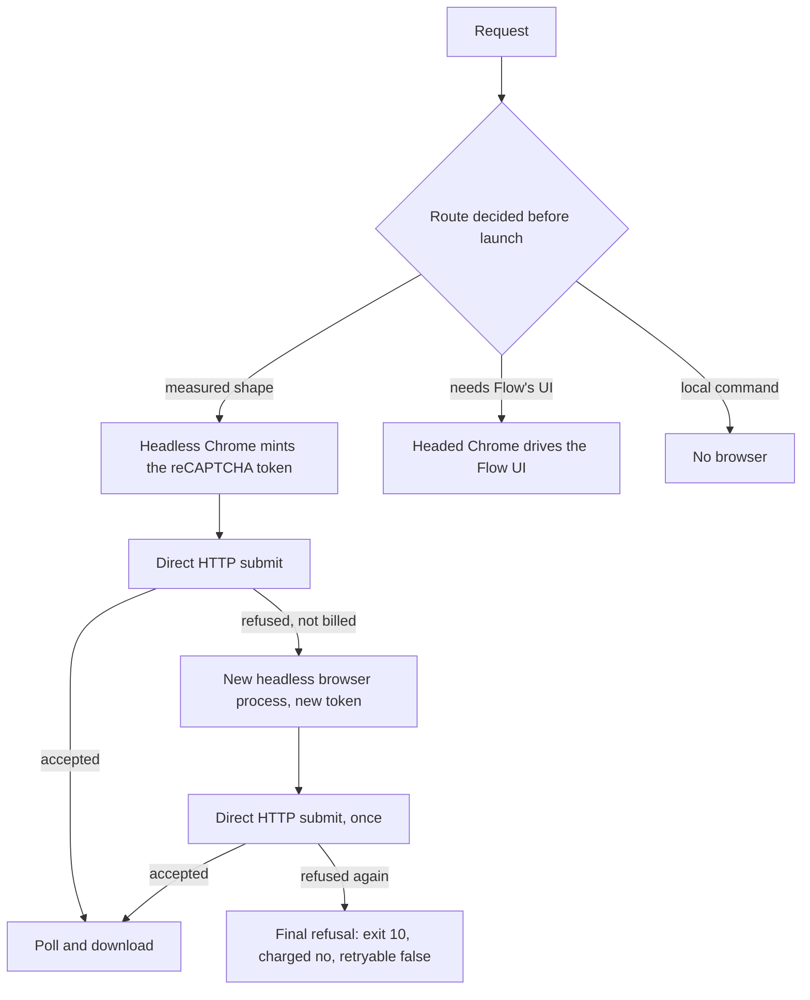

# Browser modes: does this command open a window?

Since v0.108.0, gflow-cli uses a browser only where it is strictly necessary. For the request
shapes that have been measured, Chrome starts **headless** and does one thing: it mints the
reCAPTCHA token. The request itself goes to Flow over direct HTTP. Surfaces that still need
Flow's own interface open a **headed** (visible) Chrome window. Local commands open no browser.

This page is the single source of the per-command list. The wire details of the direct path are
in [DIRECT_TRANSPORT](DIRECT_TRANSPORT.md); the settings are in
[CONFIGURATION](CONFIGURATION.md#gflow_cli_browser_visibility).

All rows below describe the default, `GFLOW_CLI_BROWSER_VISIBILITY=auto`.

## Headless (direct HTTP, the browser only mints the token)

| Command | Browser mode in v0.108.0 | Why |
|---|---|---|
| `image t2i` | headless | Text-to-image with `nano2` (any aspect, count 1-4), or `nano2-lite` / `nano-pro` at 9:16, count 1, no reference: the measured image shapes |
| `image generate` | headless | Resolves to `t2i` or `i2i`; the same rules apply to the resolved command |
| `image i2i` | headless | With `nano2` and exactly one in-project reference, or one saved character passed as `--reference-entity` with its `--reference-entity-name` (count 1-4) |
| `run` | per row | Each image row routes on its own shape; a row with a `"ref"` or a character takes the UI path, and a run with any UI row launches headed for the whole run |
| `video t2v` | headless | `--model omni-1.2-flash --duration 4 --resolution 360p`, 9:16 or 16:9, count 1: the measured text-to-video key. With no `--model`, the key is built from the model selected in the account's Flow settings, and the command goes direct when that selection forms a measured key; an explicit `--duration` or `--resolution` that no measured key carries (for example `--resolution 720p`) takes the headed UI path from the start |
| `video i2v` | headless | A **local** start frame, 9:16, the default model (Veo 3.1 Lite) or `--model veo-lite`, no `--duration` / `--resolution`: the measured image-to-video key. A JPEG whose EXIF orientation is a quarter turn (a phone photo taken upright) takes the UI path |
| `video generate` | headless | Resolves to `t2v` / `i2v` / `r2v`; the rules of the resolved command apply |
| `video upscale --scale 1080p` | headless | Only for a clip in the local catalog that is Omni 1.2 Flash, 4 s, 16:9: the measured upscale source |
| `video chain` | per clip | Direct when every clip is a measured shape; a chain with any UI clip launches headed for the whole chain |
| `serve` | same rules | The MCP tools and the HTTP endpoint route each request exactly as the CLI does; `browser_visibility` is the per-call twin of `--browser-visibility` |
| `mcp run` | same rules | As `serve` |

A zero video balance ends a planned direct video with exit 37 before any browser starts.

## Headed (Flow's UI)

| Command | Browser mode in v0.108.0 | Why |
|---|---|---|
| `auth login` | headed | Interactive sign-in; needs a display once |
| `image batch` | headed | The stay-mounted UI batch drives the composer |
| `image i2i --ref` | headed | A local `--ref` file is uploaded through the UI |
| `image upload` | headed | Uploads through the project's UI |
| `image upscale` | headed | Drives the image's download menu |
| `movie run` | headed | Scene requests carry no resolution, so no scene forms a measured key; characters and instruction cards are UI surfaces too |
| `video r2v` | headed | Reference-to-video is not measured over direct HTTP |
| `video extend` | headed | Not measured over direct HTTP |
| `video edit` | headed | Not measured over direct HTTP |
| `video i2v --end-frame` | headed | An end frame, or a start frame that is already in the project, is not a measured shape |
| `video upscale --scale 4k` | headed | 4K, 720p and the 270p GIF, and 1080p of a clip the local catalog does not hold, drive the download menu |
| `scene create` | headed | Scenes are built in the UI |
| `scene show` | headed | Reads the scene in the UI |
| `character create` | headed | Character creation is a UI surface |
| `character list` | headed | Reads the project's characters in the UI (also `character show` and `character rm`) |
| `instructions add` | headed | Agent-mode instruction cards are a UI surface (every `instructions` subcommand) |
| `media trash` | headed | Trash and restore are UI actions (also `media restore`) |
| `project create` | headed | Creates the project in the UI (also `project rename`) |
| `data sync` | headed | Reads the project in the profile's browser |
| `video t2v --max-credits` | headed | Any credit-capped video (`--max-credits`, `GFLOW_CLI_MAX_CREDITS`, MCP `max_credits`) reads Flow's quote in the UI; direct video has no wire quote |

These conditions also send a request that would otherwise go direct to the headed UI path:

- a proxy (`GFLOW_CLI_BROWSER_PROXY`, or one the environment or the operating system configures);
- an account Flow serves on labs.google, or `GFLOW_CLI_FLOW_HOST=labs.google`;
- `GFLOW_CLI_UI_MODE=agentic` (or `--ui-mode agentic`), and the agent-only composer;
- an `@Name` mention in the prompt;
- `GFLOW_CLI_TRANSPORT=ui_automation` (the kill switch, below).

## No browser

| Command | Browser mode in v0.108.0 | Why |
|---|---|---|
| `video assemble` | none | Local ffmpeg processing |
| `video captions` | none | Local ffmpeg processing |
| `video transcribe` | none | Calls the configured transcription endpoint |
| `audio narrate` | none | Calls the configured text-to-speech service |
| `docs` | none | Bundled documentation |
| `data list` | none | Local catalog (every `data` subcommand except `data sync`) |
| `telemetry status` | none | Local settings and one weekly upload (every `telemetry` subcommand) |
| `update` | none | Runs the installer |
| `models list` | none | Static model catalog (also `models show`) |
| `capabilities` | none | Static capability report |
| `cancel` | none | Local job queue |
| `auth renew` | none or headless | Refreshes saved sessions headlessly, with no sign-in |
| `credits user` | none or headless | Read directly when the saved session is accepted; otherwise in the profile's browser (also `credits list`) |

## The route rule

The route is decided **before** the browser starts, from the request alone: the command, its
options, the local catalog, and the settings above. A request goes direct only when every slot
of the frame it needs has been measured against Flow's own submit; anything else takes the UI
path. A run that holds any UI item (a chain, a `gflow run` config, a batch) launches headed for
the whole run. The route a request took is reported as `route` (`direct` / `ui`), with
`visibility` (`headless` / `headed`) and `retried`, in `--json` output, in MCP results and in the
local catalog.

## The retry rule

When Flow refuses a direct submit as `PUBLIC_ERROR_UNUSUAL_ACTIVITY`, nothing was billed. gflow
closes that browser process, starts a new headless one, mints a new token and sends the request
**once** more, logging the `mint.retried` warning. A
second refusal is final: `WafRejectionError` (exit 10) with `charged: "no"`, `retryable: false`
and `next_action: "none"`. Wait out the cooldown in
[ACCOUNT_SAFETY](ACCOUNT_SAFETY.md#when-google-does-push-back) before trying again, or run with
`--browser-visibility headed`. A failure after the request was sent is never resent: it reports
`charged: "maybe"` and `next_action: "reconcile"`. If the new browser process cannot start,
the refusal is final in the same way. When a request that reached no Flow endpoint falls back
to the UI path and its headed browser cannot start, the run ends with `RelaunchFailed` (exit
15, `charged: "no"`).

## Platforms

Measured on Windows. **macOS and Linux are unmeasured**: the headless mint is attempted there
too, and a refusal is retried once as above. Accounts Flow serves on labs.google are unmeasured
and take the UI path. A headed launch on Linux with neither `DISPLAY` nor `WAYLAND_DISPLAY` set
fails with `UiModeUnavailableError` (exit 28); a headless launch needs no display. The headless
browser announces `HeadlessChrome`; it is not stealth ([ACCOUNT_SAFETY](ACCOUNT_SAFETY.md)).

## Limits per command or job

Each limit belongs to one browser session: one CLI command, or one MCP tool call or worker job.
A long-running `gflow serve` or `gflow mcp run` opens a new session for every job, so nothing
below (the in-flight count, the start history, the armed page) carries from one job to the next.

| Value | Design value |
|---|---|
| Direct submits in flight per command or job | at most 4 (`GFLOW_CLI_CONCURRENCY` cannot raise it) |
| Start-rate warning | `direct.start_rate_high` is logged when more than 8 submits start within 120 s in one command or job; nothing is blocked, and separate jobs are not counted together |
| Re-arm | a page idle for more than 600 s (wall clock, so a resumed laptop counts) re-arms before it mints |
| Refused page | discarded; the next mint uses a new page |
| Relaunch after a refusal | at most one per refusal window: submits refused together share one fresh browser process |

## Forcing a mode

- **Show the window:** `--browser-visibility headed` on a generation command,
  `browser_visibility="headed"` on an MCP tool, or `GFLOW_CLI_BROWSER_VISIBILITY=headed`. The
  deprecated `GFLOW_CLI_HEADLESS=false` pins `headed` too; `gflow doctor` flags it.
- **Kill switch:** `GFLOW_CLI_TRANSPORT=ui_automation` (in the environment or `.env`) sends
  every request through Flow's UI, headed, as before v0.108.0.
- An explicit `--browser-visibility headless` (or `GFLOW_CLI_BROWSER_VISIBILITY` / the deprecated
  `GFLOW_CLI_HEADLESS=true`) also runs Flow UI shapes headless at the user's choice; this is
  unsupported in v0.108.0, see [#1554](https://github.com/ffroliva/gflow-cli/issues/1554).

Evidence: [the direct video and headless mint spike](superpowers/spikes/2026-11-27-direct-video-and-headless-mint.md)
([#1371](https://github.com/ffroliva/gflow-cli/issues/1371)).
