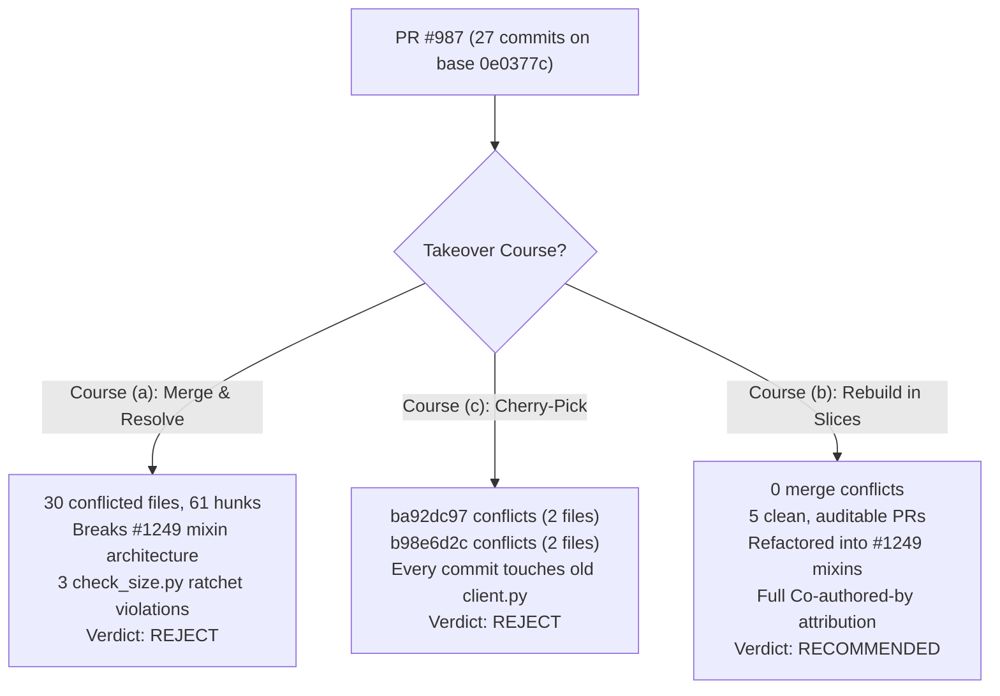
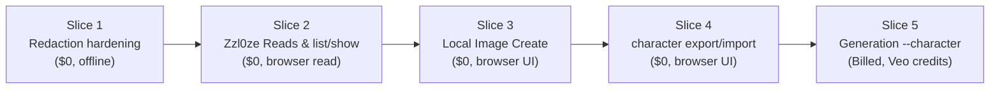

# Contributor PR #987 Takeover Assessment: Course Analysis, Predict Verdict, and Slice Plan (2026-11-15)

> **Context:** Assessment and implementation roadmap for taking over external contributor PR [#987](https://github.com/ffroliva/gflow-cli/pull/987) (authored by `@ziyedbe`, branch ref `pr-987`, addressing Issue [#639](https://github.com/ffroliva/gflow-cli/issues/639)).
> **Git Base:** `0e0377c98e` (27 commits in PR #987). Current `origin/develop` has moved **765 commits** ahead of the merge base.
> **Scope:** Assessment document only; zero production code changes.

---

## 1. Executive Summary

Contributor PR #987 contributes high-value capabilities for Flow Character portability:
- Portable character bundles (plain folder format: `manifest.json` + full-size images).
- `gflow character export` and `gflow character import` (moving characters between projects and accounts without billing or re-generation).
- `gflow character create --image FILE [--body-image FILE]` (building characters from local images via Flow's character editor, bypassing retired labs routes).
- Migrated-host character listing and inspection (`character list` and `character show` on `flow.google.com` via `Zzl0ze`).
- Generating directly from character bundles via `--character FOLDER` on image and video generation commands, with MCP parity.
- Security hardening for Flow secrets (`lh3.../asb/`, `0cAF...`, `at=`) in diagnostics and redaction.

However, since PR #987 was branched off commit `0e0377c98e`:
1. **The Modular Monolith Split (#1249 wave 2):** Develop dismantled the god classes `FlowApiClient` (`client.py`) and `MigratedComposer` (`migrated_composer.py`) into single-purpose mixins (`api/_flow_characters.py`, `_mc_common.py`, `_mc_mention.py`, `_mc_editor_gate.py`, etc.).
2. **Partial Parallel Landings:** PR #1109 separately landed `r2v` with a named character on `flow.google.com`, and PR #1114 landed cross-filesystem video relocation (`shutil.move` in `paths.py`).
3. **Mechanical Conflict Explosion:** A trial merge of `pr-987` into current `develop` yields **30 conflicted files and 61 conflict hunks**, and cannot import.
4. **Size Gate Violations:** PR #987's `migrated_character.py` introduces 3 hard violations of `scripts/ci/check_size.py` (C901 cyclomatic complexity and PLR0915 function statements). Because the file is new, the ratchet rule strictly forbids adding it to `size_baseline.json`.

**Recommended Decision:** **Course (b) — Rebuild in slices on current develop.** Port the contributor's logic and tests capability by capability directly into develop's mixin architecture, giving full author credit via `Co-authored-by: ziyedbe <ziyedbecha@hotmail.fr>` trailers on all ported commits.

---

## 2. PR #987 Capability Inventory

The inventory below analyzes PR #987 by user-facing capability rather than by raw file diff.

| Capability | Scope & PR #987 Files (Lines) | Status on `develop` (Citations) | Associated Tests in #987 | Billed / Browser Path |
|---|---|---|---|---|
| **1. Portable Character Bundle Format** | Pure domain model: `manifest.json` + images, schema v1, allowlist (no PII/account/project IDs), SHA256 integrity, container validation. `src/gflow_cli/character_bundle.py` (231 lines) `src/gflow_cli/image_files.py` (38 lines) | **Not at all** Develop has neither `character_bundle.py` nor `image_files.py`. | `tests/test_character_bundle.py` (234) `tests/features/character_bundle.feature` (20) `tests/features/test_character_bundle_steps.py` (100) | **$0, Zero browser** Pure offline Python. |
| **2. `character export` (CLI & MCP)** | Export project character to bundle folder. Reads `Zzl0ze` and downloads full-size images via FIFE `=s0` URL pattern. `cli_character.py` (~65) `services/character_portability.py` (~35) `api/client.py` (~60) `api/transports/migrated_character.py` (~150) `mcp/tools.py` (~55) | **Not at all** Develop `cli_character.py:65-70` defines only `create`, `list`, `show`, `rm`, `voices`. No `export` command or MCP twin. | `tests/cli/test_cli_character_portability.py` (~60) `tests/services/test_character_portability.py` (~100) `tests/mcp/test_character_tools.py` (~70) `tests/e2e/test_character_portability_bdd.py` (scenarios 3, 4) | **$0, Browser read-only** Playwright session to observe `Zzl0ze` and download images via `page.request`. |
| **3. `character import` (CLI & MCP)** | Rebuild character in a project from a bundle folder. Pre-validates bundle offline, validates voice against live catalog, uploads files via editor. Cross-profile via `--profile`. `cli_character.py` (~65) `services/character_portability.py` (~60) `mcp/tools.py` (~70) | **Not at all** Develop has no `import` subcommand, no service, and no MCP twin. | `tests/cli/test_cli_character_portability.py` (~68) `tests/services/test_character_portability.py` (~120) `tests/mcp/test_character_tools.py` (~74) `tests/e2e/test_character_portability_bdd.py` (scenarios 3, 4, 5) | **$0, Browser UI** Drives character editor file uploads on `flow.google.com`. |
| **4. `character create --image` (CLI & MCP)** | Create character from local image files on `flow.google.com` without generation or credits. Uploads portrait to slot 0, sets name/voice/personality, uploads body image to slot 1. `cli_character.py` (~85) `services/character_create.py` (69) `api/client.py` (~40) `api/transports/migrated_character.py` (~450) `mcp/tools.py` (~40) | **Partly / Not at all** Develop `cli_character.py:75-102` supports only prompt generation (`--face-prompt`), which exits 7 on `flow.google.com` (`KNOWN_ISSUES.md:101`). File-based creation is absent. | `tests/cli/test_cli_character_create.py` (92) `tests/services/test_character_create_from_files.py` (78) `tests/api/transports/test_migrated_character_decisions.py` (~250) `tests/e2e/test_character_portability_bdd.py` (scenario 1) | **$0, Browser UI** Playwright drives editor file upload & form controls. Zero credits. |
| **5. Migrated Host Character Reads (`list`/`show`)** | Parse flow.google.com's `Zzl0ze` RPC to extract characters, workflow IDs, media URLs, and live voice catalog (30 voices incl. Enceladus). `api/character.py` (19) `api/transports/migrated_character.py` (~200) `api/client.py` (~50) | **Not at all** Develop `api/_flow_characters.py:62-73` still only calls labs tRPC `flow.projectInitialData`, which exits 7 on migrated accounts (`KNOWN_ISSUES.md:101`). | `tests/api/fixtures/zzl0ze_reply.json` (1048) `tests/api/test_client_character_host.py` (303) `tests/api/transports/test_migrated_character.py` (267) | **$0, Browser read-only** Passive `Zzl0ze` capture on project load. |
| **6. `--character FOLDER` on Image Generation (`t2i`/`i2i`)** | Generate images directly from an exported character folder. Reuses matching character in project or imports it first (free). Enforces reference caps pre-browser. `cli_image.py` (~54) `services/character_portability.py` (~80) `mcp/tools.py` (~30) `worker/daemon.py` (~20) | **Not at all** Develop `cli_image.py:163-180` supports `--reference-entity` / `--reference-entity-name`, but NOT `--character`. Worker has no `characters` payload key. | `tests/cli/test_cli_image_character_bundle.py` (82) `tests/services/test_character_portability.py` (~90) `tests/worker/test_daemon.py` (~40) | **Billed & Browser** Consumes Imagen generation quota; bundle check and import are $0. |
| **7. `--character FOLDER` & Characters on Video (`t2v`/`r2v`)** | Repeatable `--character FOLDER` on `t2v` and `r2v`. Multiple characters per clip. Lifts `_unported_form` gate on `t2v` with characters on `flow.google.com`. `cli_video.py` (~57) `api/transports/migrated_composer.py` (~40) `mcp/tools.py` (~25) `worker/daemon.py` (~25) | **Partly** Develop #1109 lifted `_unported_form` for `r2v` only (`_mc_editor_gate.py:596-597`); `t2v` with characters still exits 36. Develop has no `--character` flag on `cli_video.py`. | `tests/cli/test_cli_video_character_bundle.py` (157) `tests/api/transports/test_migrated_r2v.py` (~100) `tests/worker/test_daemon.py` (~50) `tests/e2e/test_character_portability_bdd.py` | **Billed & Browser** Consumes Veo credits (~12 credits/clip). Video e2e strictly opt-in (`GFLOW_CLI_E2E_RUN_VIDEO=1`). |
| **8. Prompt-Positioned Character Chips** | Intersperses character chips at `@Name` mention locations in the prompt rather than prepending all chips at the start. `api/transports/migrated_composer.py` (~80) | **Not at all** Develop (`_mc_mention.py`) inserts all chips at once before or after prompt text. | `tests/api/transports/test_migrated_composer.py` (~80) | **Browser path** Typing and chip insertion in composer. |
| **9. Queued Submit Status-Poll Adoption (`[5]`)** | If `MZZa6b` returns `[5]` (queued without media ID), adopt the new clip identified by subsequent status polls. `api/transports/migrated_composer.py` (~60) | **Contradicted / Dropped** Maintainer probe proved `jwpduf` does not poll pre-click, `as29s` only fetches thumbnails; #1109 proved `[5]` no longer reproduces on live Flow. | `tests/api/transports/test_migrated_composer.py` (`test_a_queued_submit_adopts_the_new_clip_its_status_poll_names`) | **Billed / Observer** |
| **10. Cross-Filesystem Video Relocation** | Replaces `Path.rename()` with `shutil.move()` to avoid `EXDEV` exit 1 on billed clips when `--output` crosses filesystems. `cli_video.py` (~5) `mcp/tools.py` (~5) | **Fully Present on develop** Landed in #1114. Cite: `src/gflow_cli/paths.py:315-318` (`relocate_video`). | `tests/cli/test_cli_video_relocate.py` (44) | **$0, Local filesystem** |
| **11. Secret Redaction Hardening** | Free-text scrubbing for `lh3.../asb/` URLs, `0cAF...` reCAPTCHA Enterprise tokens, `at=` XSRF tokens, bounded lookbehind to prevent ReDoS, and `scrub_secrets`. `data/redaction.py` (37) `api/transports/batchexecute.py` (15) | **Not at all** Develop lacks `0cAF`, `at=` token regexes, and `scrub_secrets`. | `tests/data/test_redaction.py` (92) `tests/api/transports/test_batchexecute.py` (15) | **$0, Pure Python** |
| **12. Exact Route Matching (`is_at`)** | Replaces `current.startswith(target)` with exact host+path matching so `/project/<id>/character/<eid>` is not misidentified as `/project/<id>`. `migrated_composer.py` (15) | **Not at all** Develop `_mc_editor_gate.py:114` still uses `if not current.startswith(target):`, causing agent-only misidentification (exit 25). | `tests/api/transports/test_migrated_composer.py` (~20) | **Browser path** |
| **13. Cold Profile Create Stabilization** | Handle first-visit dialogs, cookie banner dismissal, editor load settlement, retry empty create once, redo unanswered edit. `api/transports/migrated_character.py` (~120) | **Not at all** Develop character create has no cold-profile recovery for migrated editor. | `tests/api/transports/test_migrated_character_decisions.py` (~110) | **$0, Browser UI** |

---

## 3. Course Analysis and Measured Numbers

A trial merge was executed in an isolated throwaway clone (`scripts/dev/_spike_out/987/merge_test`, deleted after measurement). Three potential takeover courses were evaluated against concrete metrics.

### Course (a): Merge-and-Resolve

- **Measured Merge Conflicts:**
  - **30 conflicted files**: `AGENTS.md`, `CHANGELOG.md`, `KNOWN_ISSUES.md`, `docs/CONFIGURATION.md`, `docs/MCP.md`, `docs/PROJECT_STATUS.md`, `docs/REFERENCE_STRATEGIES.md`, `docs/USAGE.md`, `llms.txt`, `plugins/gflow/skills/gflow-cli/SKILL.md`, `plugins/gflow/skills/video-production/SKILL.md`, `skills/gflow-cli/SKILL.md`, `skills/video-production/SKILL.md`, `src/gflow_cli/api/client.py`, `src/gflow_cli/api/transports/batchexecute.py`, `src/gflow_cli/api/transports/migrated_composer.py`, `src/gflow_cli/cli_image.py`, `src/gflow_cli/cli_video.py`, `src/gflow_cli/mcp/tools.py`, `src/gflow_cli/worker/daemon.py`, `tests/api/transports/test_migrated_composer.py`, `tests/api/transports/test_migrated_dispatch.py`, `tests/api/transports/test_migrated_r2v.py`, `tests/data/test_redaction.py`, `tests/worker/test_daemon.py`, `website/docs/CHARACTER.md`, `website/docs/CONFIGURATION.md`, `website/docs/KNOWN_ISSUES.md`, `website/docs/MCP.md`, `website/docs/USAGE.md`.
  - **61 conflict hunks** across those 30 files.
- **Architectural Collision:**
  - In PR #987, `client.py` has 7 conflict hunks and `migrated_composer.py` has 6 conflict hunks.
  - On develop, PR #1249 dismantled `client.py` into mixins (`api/_flow_characters.py`, `_flow_session.py`, `_flow_workspace.py`) and split `migrated_composer.py` into 7 stage mixins (`_mc_common.py`, `_mc_mention.py`, `_mc_editor_gate.py`, `_mc_submit_observe.py`, etc.).
  - Resolving conflicts directly into `client.py` and `migrated_composer.py` undoes the #1249 modularization and breaks type resolution.
- **Syntax and Importability:** Merged tree does not import. Even with conflict markers manually wiped, method call discrepancies between monolithic `client.py` and modular `_flow_characters.py` cause runtime `AttributeError`s.
- **Size Gate Violations (`scripts/ci/check_size.py`):**
  Running `ruff check --select C901,PLR0915` on `src/gflow_cli/api/transports/migrated_character.py` yields 3 hard errors:
  1. `C901: _rpc_replies is too complex (11 > 10)`
  2. `C901: create_from_files is too complex (18 > 10)`
  3. `PLR0915: create_from_files has too many statements (65 > 50)`
  Because `migrated_character.py` is a newly introduced file, `size_baseline.json` cannot be updated to exempt it (ratchet rule: baselines may only shrink, never grow). CI fails unconditionally.
- **Documentation & Plugin Drift:** Manual edits in `website/docs/` (6 files) and `plugins/` (2 files) fail `generate_website_docs.py --check` and `generate_plugin_skills.py --check`.
- **Effort & Risk:** 30–40 hours of conflict resolution; extreme risk of behavioral regressions.

### Course (c): Cherry-Pick Self-Contained Commits

- **Trial Cherry-Picks:**
  - Cherry-picking the earliest isolated fix, commit `ba92dc97` ("fix(redaction): scrub flow.google.com batchexecute secrets"), immediately failed with:
    `CONFLICT (modify/delete): docs/superpowers/plans/2026-10-16-character-portability/PLAN.md deleted in HEAD and modified in ba92dc97`
    `CONFLICT (content): Merge conflict in tests/data/test_redaction.py`
  - Cherry-picking commit `b98e6d2c` ("feat(character): a portable character bundle") immediately failed with:
    `CONFLICT (modify/delete): docs/superpowers/plans/.../PLAN.md`
    `CONFLICT (content): Merge conflict in src/gflow_cli/api/client.py`
- **Root Cause:** All 27 commits repeatedly modified `PLAN.md` (which does not exist on `develop`), `CHANGELOG.md`, and the pre-split `client.py`.
- **Verdict:** True clean cherry-picking is mathematically impossible; every cherry-pick requires manual hunk surgery and leaves a broken commit history.

### Course (b): Rebuild in Slices on Current Develop (Recommended)

- **Mechanics:** Port the contributor's logic, models, and tests capability by capability directly into develop's post-#1249 mixin structure (`_flow_characters.py`, `_mc_mention.py`, `_mc_editor_gate.py`).
- **Authorship Preservation:** Full attribution via `Co-authored-by: ziyedbe <ziyedbecha@hotmail.fr>` on all commits, with PR descriptions and release notes citing #987 and @ziyedbe.
- **Numbers:**
  - **0 git merge conflicts.**
  - 5 clean, bite-sized PR slices (~400–1,200 lines each).
  - Code lands directly into the proper architectural boundaries.
  - Functions exceeding `check_size.py` limits (`create_from_files`, `_rpc_replies`) are decomposed during porting, satisfying the size ratchet with zero baseline expansion.
  - Superseded code is omitted cleanly (e.g. `shutil.move` already in #1114; status-poll adoption disproved by maintainer probe).
- **Effort & Risk:** 12–16 hours total; low risk, high test confidence per slice.

### Course Comparison Matrix

| Evaluation Dimension | Course (a): Merge & Resolve | Course (b): Rebuild in Slices (Recommended) | Course (c): Cherry-Pick & Rebuild |
|---|---|---|---|
| **Conflict Count** | 30 files, 61 hunks | **0 files, 0 hunks** | 24+ commits conflict on cherry-pick |
| **Effort Estimate** | 30–40 hours | **12–16 hours** (partitioned) | 25–35 hours |
| **Risk of Regressions** | Extreme (massive blind diff) | **Very Low** (gated per capability) | High (patch resolution errors) |
| **Review Load** | Unreviewable (84 files, 10k lines) | **Clean (400–1,200 lines per PR)** | Fragmented & noisy |
| **Architecture Fit** | Re-introduces god-class patterns | **Maintains #1249 mixin modularity** | Degrades mixin separation |
| **Size Gate Compliance** | Fails (3 un-ratchet-able violations) | **Passes (refactored on ingestion)** | Fails without immediate refactoring |
| **Attribution Quality** | High (commit SHAs preserved) | **High (`Co-authored-by` on all commits)** | Mixed (patch authorship conflicts) |
| **Maintainer Ownership (1 yr)** | High tech debt, brittle coupling | **Clean, modular, maintainable** | Patchwork tech debt |

---

## 4. Multi-Persona Adversarial Predict Analysis

The recommended course (Course b) was evaluated against the five expert personas defined in `skills/predict/SKILL.md`.

### Persona Findings

#### 1. Architect — GO (9/10)
- **Dependency Rule:** Preserved completely. `character_bundle.py` is a pure domain entity with zero Playwright or Flow dependencies. `services/character_portability.py` provides application-level orchestration.
- **Module Boundaries:** Fits perfectly into develop's modular structure. Character operations land in `src/gflow_cli/api/_flow_characters.py` (composed into `FlowApiClient`), editor UI logic lands in `_ui_character.py` and `_mc_mention.py`, avoiding any regression back to monolithic `client.py`.
- **Architectural Health:** Avoids polluting `client.py` with 267 obsolete lines and keeps classes well under the 1,000-line class limit.

#### 2. Security / reCAPTCHA — GO (9/10)
- **Bundle Ingestion Defense:** Untrusted bundle directories are rigorously validated before touching Flow: checks file extensions, verifies image magic bytes (`image_files.py`), restricts file sizes to <=20 MB, enforces SHA256 checksums, strips bidi/control characters from strings, and rejects symlinks and directory traversal.
- **Secret Scrubbing:** Porting the pattern work into `data/redaction.py` scrubs `0cAF...` tokens, the bare `at` XSRF value, and `lh3.../asb/` URLs on the paths that go through `redact_error_detail` / `scrub_secrets` (persisted error details, transport snippets, worker payloads, discovery heads). It is not a guarantee for every log line: three DOM-text sites (`agent_only_composer.py:553`, `:626`, `_mc_editor_gate.py:387`) still slice before they redact, and they carry page text rather than token-dense replies.
- **Trust Boundary:** No self-minted reCAPTCHA tokens or G12 stealth bypasses; automation uses real Chrome profiles under `GFLOW_CLI_HOME`.

#### 3. Performance / Playwright — GO (8/10)
- **Offline Pre-Flight:** `validate_bundles` and voice checks run *before* acquiring a browser page, ensuring malformed inputs fail immediately with $0 and 0 ms browser time.
- **Browser Lifecycle:** Adheres to `_checkout_page` / `_checkin_page` lifecycle; avoids page pool starvation.
- **Observer Efficiency:** Dropping the disproven status-poll adoption logic avoids unnecessary polling delays.
- **Route Optimization:** Exact route matching via `is_at` avoids unnecessary 20–30 s timeout loops when navigating SPA routes.

#### 4. CLI and MCP UX / Cross-Platform — GO (9/10)
- **MCP Parity:** Every slice simultaneously updates CLI commands and MCP tool twins (`gflow_character_export`, `gflow_character_import`, `gflow_character_create(portrait=...)`, and `characters` params on generation tools). Automated parity gate (`tests/mcp/test_cli_parity.py`) remains 100% green.
- **Exit Codes:** Strict RFC 9457 compliance: Exit 11 (`ConfigurationError`) for validation and voice mismatch, Exit 7 (`WireFormatError`) for drifted RPCs, Exit 27 for rejected uploads.
- **Cross-Platform Safety:** Handles paths via `Path`, UTF-8 encoding across OSes, and Rich markup escaping prevents character names containing brackets (`[...]`) from crashing terminal output.

#### 5. Devil's Advocate — GO (9/10)
- **YAGNI / Simplification:** Course (b) enables shedding dead/superseded code:
  - Drop status-poll adoption (`[5]`) — disproved by maintainer probe.
  - Drop redundant `shutil.move` in `cli_video.py` — already solved by #1114 in `paths.py`.
  - Drop manual edits to generated docs (`website/docs/` and `plugins/`).
- **Delivery Risk:** Slicing decouples risk: Slices 1–4 are completely free ($0 credits) and deliver the core character portability feature without spending Veo video credits.

### Predict Synthesis

- **Tally Signals:** All 5 personas aligned on Course (b) as the only structurally sound path.
- **Conflicts Resolved:**
  - *Attribution vs Clean History:* Retaining original commit SHAs via Course (a) is vastly outweighed by the 30-file merge conflict and broken size gates. Course (b) preserves complete authorship through `Co-authored-by` trailers and PR provenance.
- **Confidence Score:** Average: 8.8 / 10. Upgraded by +1 for 5-persona consensus -> **9.8 / 10**.

### Predict Verdict: **GO** (Confidence: 9.8/10)

> **Coordinator note (2026-11-15):** the five personas above were played by one model
> (Gemini 3.8 Flash; the Claude band was out of quota), so this verdict is a pre-read, not a
> council. The course choice rests on the measured numbers in section 3 (re-checked: ruff on
> `pr-987:src/gflow_cli/api/transports/migrated_character.py` gives C901 18 and 11, PLR0915
> 65, PLR0912 15). Each slice gets its own `/gflow:predict` before code. Item 9 (drop the
> `[5]` adoption) is re-verified on current develop before it is dropped.

---

## 5. Slice Implementation Plan

The takeover is partitioned into 5 independent, ordered PR slices against `develop`.

> **Coordinator rescoping (2026-11-15).** Each slice ships only code that something in that slice
> calls. Slice 1 is the redaction hardening alone, from `ba92dc97` and `f1fbe256`:
> - the `lh3…/asb/` URL;
> - the bare `at` value (`<token>:<13-digit ms>`), since develop already scrubs the `at=` form
>   field (#1229);
> - `0cAF…` tokens;
> - the anchored signed-query pattern;
> - scrub-then-slice in `batchexecute._discovery_head`, through `scrub_secrets` (its caller).
>
> The contributor's generic "120 or more token characters" rule is **dropped**: it erased Flow
> media ids and cut Bearer tokens and addresses in two (PR #1302 review). Do not bring it back.
>
> These move to the slices whose callers they serve:
> - a public `discovery_head` goes to slice 3, with `migrated_character.py`;
> - `generation_records` serves only the dropped `[5]` adoption;
> - `character_bundle.py` and `image_files.py` go to slice 4, with export/import.

### Slice 1: Redaction Hardening (PR #1302)
- **Scope:** `src/gflow_cli/data/redaction.py` and `batchexecute._discovery_head`, as the rescoping note above lists. `image_files.py` and `character_bundle.py` are in slice 4.
- **Contributor Commits Ported:** `ba92dc97`, `f1fbe256`.
- **MCP Twin:** none; no CLI or MCP surface changes, so the parity gate is unaffected.
- **E2E & Cost:** **$0, offline.** Tests: `tests/data/test_redaction.py`, `tests/api/transports/test_batchexecute.py`.
- **Main Risk:** Regex performance on large payloads. *Mitigation:* bounded patterns, a token-by-token signed-query check, and timing tests on 160 KB inputs.

### Slice 2: Migrated Host Character Reads (`Zzl0ze`) + `character list` / `show`
- **Scope:**
  - `src/gflow_cli/api/transports/migrated_character.py`: Pure `Zzl0ze` parser extracting `Character` entities, workflow IDs, media URLs, and 30 live voices.
  - `src/gflow_cli/api/character.py`: Update `VOICES` to include `Enceladus`.
  - `src/gflow_cli/api/_flow_characters.py`: Add `list_characters`, `get_character`, and `list_voices` support for `flow.google.com` (via observed-refusal fallback).
  - `src/gflow_cli/api/transports/_mc_editor_gate.py`: Implement `is_at` exact route matching (replacing `startswith`) to fix route entrapment.
- **Contributor Commits Ported:** `16eae816`, `bd17e798`, parts of `fb0d3ac3` / `c803be7b`.
- **MCP Twin:** `gflow_character_list`, `gflow_character_show` (docstrings and behavior updated).
- **E2E & Cost:** **$0, zero credits.** Opt-in live read test via `GFLOW_CLI_E2E_RUN_CHARACTER=1`.
- **Main Risk:** Drift in Flow's `Zzl0ze` project listing payload format. *Mitigation:* Validated against fixture `tests/api/fixtures/zzl0ze_reply.json`.

### Slice 3: Local Image Character Creation (`character create --image`)
- **Scope:**
  - `src/gflow_cli/api/transports/migrated_character.py`: Implement `create_from_files`, `_upload_body`, and `patch_character`. Decompose functions to satisfy `check_size.py` (C901 <= 10, PLR0915 <= 50).
  - `src/gflow_cli/api/_flow_characters.py`: Add `create_character_from_files`.
  - `src/gflow_cli/services/character_create.py`: Add `character_create_from_files` saga.
  - `src/gflow_cli/cli_character.py`: Add `--image` and `--body-image` options (mutually exclusive with prompt flags).
  - Cold profile stabilization: dismiss cookie banner/dialogs, editor settlement, retry empty create once.
- **Contributor Commits Ported:** `3dc0b44e`, `3b178e4f`, `e41a9424`, `c803be7b`, `7fb819e8`.
- **MCP Twin:** Add `portrait` and `body_image` options to `gflow_character_create`. Parity gate verified.
- **E2E & Cost:** **$0, zero credits.** (Reference image uploads only). Opt-in via `GFLOW_CLI_E2E_RUN_CHARACTER=1`.
- **Main Risk:** Selector drift on editor Upload buttons. *Mitigation:* Anchors rely on structural `[role=button]` and `file` input controls; verified against `C4BZMd` and `rzMKMb` RPC replies.

### Slice 4: Character Export & Import Services and CLI
- **Scope:**
  - `src/gflow_cli/services/character_portability.py`: Implement `export_character` and `import_character`.
  - `src/gflow_cli/api/_flow_characters.py`: Implement `read_character_for_export` with FIFE `=s0` full-size downloads.
  - `src/gflow_cli/cli_character.py`: Add `export` and `import` subcommands with Rich markup escaping.
  - Offline pre-flight validation and target-account live voice check before any upload.
- **Contributor Commits Ported:** `f2fdebb8`, `dbc743b7`, `b87275ad`.
- **MCP Twin:** Implement `gflow_character_export` and `gflow_character_import` in `src/gflow_cli/mcp/tools.py`. Update `tests/mcp/test_cli_parity.py`.
- **E2E & Cost:** **$0, zero credits.** Tested via BDD feature `tests/features/character_portability.feature` (scenarios 3, 4, 5).
- **Main Risk:** Network interruption during multi-image export/import. *Mitigation:* Manifest validated offline first; partial failures report orphan entity ID without destructive deletion.

### Slice 5: Generation Commands Integration (`--character FOLDER` on Image & Video)
- **Scope:**
  - `src/gflow_cli/services/character_portability.py`: Add `apply_character_bundles` and `validate_bundles`.
  - `src/gflow_cli/cli_image.py`: Add `--character` to `t2i` and `i2i`, reference cap validation, reuse-or-import logic.
  - `src/gflow_cli/cli_video.py`: Add repeatable `--character` to `t2v` and `r2v`, lift `_unported_form` gate on `t2v` with characters on `flow.google.com`, multiple characters per clip.
  - `src/gflow_cli/api/transports/_mc_mention.py`: Support prompt-positioned character chips (`@Name`).
  - `src/gflow_cli/worker/daemon.py` & `codec.py`: Support `characters` payload key for queued tasks.
- **Contributor Commits Ported:** `24bc1ada`, `a882d788`, `fb0d3ac3`, `466e36d2`, `d556adb8`, `7ecab5f9`.
- **MCP Twin:** Add `characters` parameter to `gflow_generate_image` and `gflow_generate_video`.
- **E2E & Cost:** Image path: $0 (daily quota). Video path: **Consumes Veo credits** (~12 credits/clip). Video e2e strictly gated behind `GFLOW_CLI_E2E_RUN_VIDEO=1`.
- **Main Risk:** Composer caret placement and chip insertion timing. *Mitigation:* Verified on image paths first ($0) before executing credited video tests.

---

## 6. Dropped Scope Register

The following elements from PR #987 must be explicitly discarded:

1. **Queued Submit Status-Poll Adoption (`[5]`) (`59652d36`):**
   - *Reason:* Maintainer probe (#723) conclusively proved Flow does not poll before submit, and `as29s` returns only thumbnails. PR #1109 proved `[5]` no longer reproduces on live Flow. Introducing speculative polling adds brittle complexity for a non-existent wire symptom.
2. **Redundant `shutil.move` in `cli_video.py`:**
   - *Reason:* Already resolved on `develop` in `src/gflow_cli/paths.py:315-318` (`relocate_video`) via PR #1114.
3. **Manual Edits to Generated Files:**
   - *Reason:* Edits to `website/docs/` and `plugins/gflow/skills/` violate generator hygiene gates (`generate_website_docs.py --check`, `generate_plugin_skills.py --check`). These must be generated mechanically.
4. **Monolithic Placement in `client.py` and `migrated_composer.py`:**
   - *Reason:* Violates develop's post-#1249 modularization. Logic must reside in `_flow_characters.py`, `_mc_mention.py`, `_mc_editor_gate.py`.
5. **Oversized Functions in `migrated_character.py`:**
   - *Reason:* `create_from_files` (65 statements, complexity 18) and `_rpc_replies` (complexity 11) fail `scripts/ci/check_size.py`. Ratchet rules prevent exempting them; they must be refactored into smaller units during Slice 3.

---

## 7. What Could Not Be Measured

1. **Live Multi-Character Video Generation:** Live Flow commands are strictly prohibited in this assessment session. Video generation with multiple character chips (`--character`) has not been run against current production Flow in this pass.
2. **Account-Level WAF Impact of Rapid Uploads:** Whether creating multiple characters back-to-back from local files triggers unusual activity challenges on fresh profiles cannot be measured offline.
